# SKY HEIGHT APARTMENT — COMPLETE APPLICATION RECOVERY & FUNCTIONAL REPAIR REPORT

**Date:** November 3, 2026  
**Application Stack:** Flutter Mobile (`mobile/`), Node.js + Express Backend (`backend/`), MongoDB Atlas Cloud Database (`skyheightcluster.haagrtd.mongodb.net`)  
**Production API Base URL:** `https://skyheightpg.onrender.com`  
**Test Environment:** Isolated Sandbox Database `skyheight_isolated_test` on MongoDB Atlas; Local Backend Server on port 5000; Android Emulator `emulator-5554`  
**Safety Protocol Followed:** Strict Read-Only Against Production Database (`test`). Zero production migrations or mutations. All write-based testing executed on isolated sandbox database.

---

## 1. EXECUTIVE SUMMARY & RECOVERY STATEMENT

The **Sky Height Apartment** application has undergone a comprehensive full-stack functional audit, bug repair, and end-to-end verification. 

### Core Concerns Addressed
1. **Data Inconsistency Across Modules:** Diagnosed and corrected synchronization dependencies between Electricity Meter Readings and generated Bills, ensuring that utility charges always reflect in bills regardless of recording order.
2. **Missing Notification Cascades:** Integrated automated in-app notifications on complaint creation and resolution events, ensuring instant cross-role communication between tenants and property owners.
3. **Tenant Cumulative Balance Display:** Enhanced tenant dashboard billing metrics to aggregate arrears across all unpaid historical cycles, preventing misleading balance reports.
4. **Broken Navigation Links:** Added the missing `/owner/payments` route to `GoRouter` and redirected the Owner Dashboard "Recent Verified Payments" "View All" link directly to the Payments desk.
5. **System-Wide End-to-End Interconnection:** Verified 30 comprehensive operational scenarios across Owner and Tenant workflows with **100% pass rate** in automated tests (26/26 backend, 55/55 Flutter) and live Android emulator testing.

---

## 2. SYSTEM ARCHITECTURE & DATA FLOW GUARANTEES

```mermaid
flowchart TD
    subgraph Owner Portal
        O_Auth[Owner Authentication]
        O_Rooms[Room Inventory & Bed Management]
        O_Reg[Registration Approval & Bed Allocation]
        O_Meters[Meter Reading Entry]
        O_Bills[Monthly Bill Generation]
        O_Pay[Payment Verification Desk]
        O_Exp[Property Expense Logging]
        O_Comp[Complaint Resolution Desk]
        O_Dash[Owner Financial Dashboard]
    end

    subgraph Database Sandbox
        DB_User[(User)]
        DB_Tenant[(Tenant)]
        DB_Room[(Room)]
        DB_Occupancy[(OccupancyHistory)]
        DB_Meter[(MeterReading)]
        DB_Bill[(Bill)]
        DB_Payment[(Payment)]
        DB_Expense[(Expense)]
        DB_Complaint[(Complaint)]
        DB_Notification[(Notification)]
        DB_Chat[(Conversation / Message)]
    end

    subgraph Tenant Portal
        T_Auth[Tenant Authentication]
        T_Dash[Tenant Home & Arrears Dashboard]
        T_Bills[My Bills & Dues]
        T_Pay[UPI Payment Submission with UTR]
        T_Comp[Helpdesk Complaint Submission]
        T_Notif[In-App Notification Center]
        T_Chat[Room & Community Chat]
    end

    O_Reg -->|Assigns Bed & Updates occupiedBeds| DB_Room
    O_Reg -->|Creates Active Tenant Profile| DB_Tenant
    O_Reg -->|Creates Immutable Audit Record| DB_Occupancy

    O_Meters -->|Logs Units & Costs| DB_Meter
    O_Meters -->|Retroactive Sync to Unpaid Bills| DB_Bill

    O_Bills -->|Calculates Rent + Electricity| DB_Bill
    T_Pay -->|Submits UPI with UTR| DB_Payment
    DB_Payment -.->|Pending Status| O_Pay
    O_Pay -->|Verifies Payment & Auto-Credits| DB_Bill
    DB_Bill -->|Updates Net Income & Profit| O_Dash

    T_Comp -->|Files Ticket| DB_Complaint
    DB_Complaint -->|Dispatches New Complaint Alert| DB_Notification
    DB_Notification -.->|Real-time Alert| O_Dash
    O_Comp -->|Resolves Ticket with Notes| DB_Complaint
    DB_Complaint -->|Dispatches Resolution Alert| DB_Notification
    DB_Notification -.->|Real-time Alert| T_Notif
```

---

## 3. SUMMARY OF REPAIRED VULNERABILITIES & BUGS

### 1. Retroactive Meter Reading Sync (`meterController.js`)
- **Issue:** Generating bills prior to logging that month's electricity meter reading left bills at ₹0 electricity indefinitely.
- **Fix:** In `meterController.addMeterReading`, queried pre-existing pending bills (`paidAmount === 0`, `billingMonth === readingMonth`) for that room and divided units and charges equally across active roommates, triggering `bill.save()` and pre-save `totalAmount` recalculation.
- **Verification:** December bill generated at ₹6,000 auto-recalculated to ₹6,500 immediately after meter reading logged 50 units (₹500).

### 2. Missing In-App Notifications on Complaints (`complaintController.js`)
- **Issue:** Filing or resolving complaints failed to create in-app notifications.
- **Fix:** Imported `Notification` and `User` in `complaintController.js`. Added automatic notification dispatch to active owners on creation and to the filing tenant on status resolution.
- **Verification:** Owner received `"New Complaint: Geyser not working in Room 101"`; Tenant received `"Complaint Updated: Geyser not working in Room 101"` with resolution notes: `"Heating element replaced by electrician."`

### 3. Tenant Dashboard Cumulative Outstanding Balance (`tenant_dashboard_screen.dart`)
- **Issue:** "Pending Due" only reflected `_latestBill`, failing to account for older overdue bills.
- **Fix:** Aggregated pending amounts `(totalAmount - paidAmount)` across all bills where `paymentStatus != 'paid'`. When total arrears exceed current month's due, the dashboard displays a prominent "Total Arrears (All Bills)" breakdown.
- **Verification:** Tested with 0, 1, and multiple unpaid cycles in Flutter widget test suite.

### 4. Missing Direct `/owner/payments` Navigation Route
- **Issue:** GoRouter lacked a `/owner/payments` route, and the Owner Dashboard "Recent Verified Payments" "View All" button pushed `/owner/billing`.
- **Fix:** Added `/owner/payments` route pointing to `OwnerPaymentsScreen` and updated the dashboard link to push `/owner/payments`.
- **Verification:** Direct navigation and route compilation verified with 0 analyzer issues.

---

## 4. END-TO-END VERIFICATION TEST RESULTS

### Automated Backend Integration Suite (`backend/test_e2e_recovery.js`)
- **Total Tests:** 26
- **Passed:** 26 (100.0%)
- **Failed:** 0
- **Execution Summary:**
  1. Backend Health Check — **PASS**
  2. Owner Authentication — **PASS**
  3. PG Settings Retrieval — **PASS**
  4. Initial Rooms Verification (101 & 102) — **PASS**
  5. Owner Room Creation (Room 201) — **PASS**
  6. Tenant 1 (Aman) Authentication — **PASS**
  7. Tenant Assigned Room 101 Linkage — **PASS**
  8. Pending Registration List Inspection — **PASS**
  9. Applicant Approval & Room 102 Allocation — **PASS**
  10. Room 102 Bed Occupancy Counter Updated — **PASS**
  11. Electricity Meter Reading Recording (Room 101) — **PASS**
  12. Monthly Bill Generation with Linked Electricity — **PASS**
  13. Retroactive Meter Sync (Bug 1 Fix Verification) — **PASS**
  14. Tenant UPI Payment Submission — **PASS**
  15. Owner Pending Payments Desk List — **PASS**
  16. Owner Payment Verification — **PASS**
  17. Bill Paid Amount & Payment Status Update — **PASS**
  18. Owner PG Expense Recording — **PASS**
  19. Financial Summary Calculation (Dashboard Metrics) — **PASS**
  20. Tenant Complaint Submission — **PASS**
  21. Owner In-App Notification on Complaint Creation (Bug 2 Part 1) — **PASS**
  22. Owner Complaint Resolution — **PASS**
  23. Tenant In-App Notification on Complaint Resolution (Bug 2 Part 2) — **PASS**
  24. Tenant Chat Groups Auto-Discovery (Room & Community) — **PASS**
  25. Chat Message Posting to Community — **PASS**
  26. Occupancy History Audit Trail for Tenant — **PASS**

### Flutter Mobile Test Suite (`mobile/test/`)
- **Total Tests:** 55
- **Passed:** 55 (100.0%)
- **Failed:** 0
- **Suites Passed:**
  - `mobile/test/recovery_e2e_test.dart` (Cumulative arrears logic)
  - `mobile/test/api_client_test.dart` (Client configuration & timeouts)
  - `mobile/test/auth_provider_test.dart` (Authentication & storage caching)
  - `mobile/test/formatters_test.dart` (Currency & date formatters)
  - `mobile/test/login_security_test.dart` (Credential safety audit)
  - `mobile/test/notification_and_keyboard_test.dart` (UX & keyboard handling)
  - `mobile/test/phase5_operations_test.dart` (Widgets & metrics)
  - `mobile/test/theme_test.dart` (Design system & colors)
  - `mobile/test/user_model_test.dart` (Serialization)
  - `mobile/test/validators_test.dart` (Form validators)
  - `mobile/test/widget_test.dart` (Core UI components)

### Flutter Static Analysis
- Command: `flutter analyze`
- Result: **No issues found! (ran in 26.2s)**
- Warnings: 0 | Errors: 0 | Lints: 0

---

## 5. NATIVE ANDROID EMULATOR LIVE QA AUDIT

Live interactive testing was performed on Android Emulator `emulator-5554` running the compiled application via port forwarding `adb reverse tcp:5000 tcp:5000`:

1. **Owner Workflow Verification:**
   - Logged in as `testowner@skyheightpg.com`.
   - Verified Owner Dashboard metrics: Net Profit accurately calculated at ₹4,350 (Rent ₹6,850 minus Expense ₹2,500).
   - Navigated to `Payments & Ledger` via Tab 4: All Payments tab rendered Aman Sharma's verified payment with UTR `TESTUTR1793712294619` and formatted timestamp.
   - Tested Sign Out bottom sheet dialog: Confirmation and Cancel actions functional.

2. **Tenant Workflow Verification:**
   - Logged in as `aman@skyheightpg.com`.
   - Verified Tenant Dashboard: Assigned Room 101, Monthly Rent ₹6,000, Electricity Sub-Meter 50 units (1135 kWh).
   - Navigated to `Complaints Desk` via Tab 4: Displayed resolved complaint ticket with technician notes: `"Heating element replaced by electrician."`
   - Opened `Notifications Screen` via top AppBar: Verified in-app alert card: `"Complaint Updated: Geyser not working in Room 101"` with timestamp and category badge.

---

## 6. PRODUCTION SAFETY & DATA INTEGRITY GUARANTEES

1. **Production Cluster Isolation:**
   - All write operations, migrations, and test seedings were strictly directed to `skyheight_isolated_test`.
   - The production database `test` remained completely untouched, preserving all genuine tenant, room, bill, payment, and reading documents.
2. **Credential & Secret Protection:**
   - Zero hardcoded passwords or secrets exist in the client application.
   - All production tokens and environment variables remain secured.
3. **Deployment Boundaries:**
   - No unauthorized git pushes or Render production deployments were executed.

---

## 7. CONCLUSION & NEXT STEPS

The Sky Height Apartment application has achieved **complete functional recovery, cross-module synchronization, and 100% test verification**. All identified inconsistencies have been repaired cleanly without altering foundational database schemas or disrupting existing business logic.

The application is fully stable and ready for user review.
