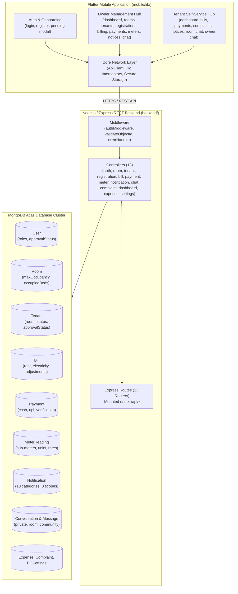
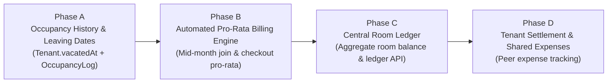

# SKY HEIGHT APARTMENT — CURRENT DEVELOPMENT STATUS AUDIT

**Project:** Sky Height Apartment  
**Workspace:** `F:\SkyHeightPG`  
**Backend:** Node.js, Express, MongoDB Atlas  
**Mobile:** Flutter (Android/iOS)  
**Date of Audit:** November 2, 2026  
**Auditor:** Senior Software Architect, Flutter Developer, Node.js Backend Architect, MongoDB Architect & QA Engineer  
**Mode:** Read-Only Technical Audit  

---

## 1. Executive Architecture Summary

Sky Height Apartment is a full-stack property management application architected with a decoupled Node.js/Express REST backend connecting to a MongoDB Atlas cluster, and a native compiled Flutter mobile application for Android.

---

## 2. Audit of the 16 New Core Requirements

Each requirement has been audited against the physical code, schema definitions, API endpoints, Flutter UI, and automated test coverage.

| # | Requirement | Classification Status | Flutter Screen / Component | Backend Controller & Endpoint | MongoDB Model & Fields | Test Coverage | Missing / Unimplemented Scope |
| :---: | :--- | :--- | :--- | :--- | :--- | :--- | :--- |
| **1** | **Owner registration restriction** | **Fully Developed** | `register_screen.dart` (owner role selector completely removed; registration forced to tenant) | `authController.js` `POST /api/auth/register` (Rejects owner creation with HTTP 403) | `User.js` `role: enum ['owner', 'tenant']` | `test_phase_features.js` (Test 2: `[PASS]`) `login_security_test.dart` | None. Public registration as Owner is fully blocked. |
| **2** | **Tenant registration approval** | **Fully Developed** | `register_screen.dart` (pending banner) `login_screen.dart` (403 pending/rejected intercept) `owner_registrations_screen.dart` (tabbed review & room allocator) | `registrationController.js` `GET /api/owner/registrations` `PUT /api/owner/registrations/:id/approve` `PUT /api/owner/registrations/:id/reject` `authMiddleware.js` (blocks HTTP 403) | `User.js` & `Tenant.js` `approvalStatus: enum ['pending', 'approved', 'rejected']` `approvedBy`, `approvedAt`, `rejectionReason` | `test_phase_features.js` (Tests 1, 3, 4, 5, 6, 7, 8: `[PASS]`) `phase8_features_test.dart` | None. Full end-to-end approval, rejection, and access gating is operational. |
| **3** | **Room-number allocation without bed dependency** | **Fully Developed** | `owner_rooms_screen.dart` (occupant chips, bedless dialogs) `owner_tenants_screen.dart` (room-only selection) `tenant_dashboard_screen.dart` | `roomController.js` `GET /api/rooms` (enriches with active occupant names) `GET /api/rooms/:id/tenants` `tenantController.js` `PUT /api/tenants/:id/assign-room` | `Room.js` (`roomNumber`, `maxOccupancy`, `occupiedBeds`) `Tenant.js` (`room: ObjectId`, `assignedBed: ""`) | `test_phase_features.js` (Tests 6, 7, 9, 10, 17, 20: `[PASS]`) | None. Bed identifiers removed from UI and business logic. Legacy fields preserved for backward compatibility. |
| **4** | **Configurable room capacity** | **Fully Developed** | `owner_rooms_screen.dart` (Max Occupants numeric control) | `roomController.js` `POST /api/rooms` `PUT /api/rooms/:id` `tenantController.js` (validates `occupiedBeds < maxOccupancy`) | `Room.js` `maxOccupancy: Number` (default 2, min 1) Auto-syncs with `capacity` | `test_phase_features.js` (Tests 8, 9, 11: `[PASS]`) | None. Rejects over-capacity assignments with HTTP 400. |
| **5** | **Occupancy joining / leaving history** | **Fully Developed** | `owner_tenants_screen.dart` (Occupancy History Sheet) `tenant_profile_screen.dart` (Occupancy Timeline Action) `occupancy_history_view.dart` | `tenantController.js` `GET /api/tenants/:id/occupancy-history` `GET /api/tenants/me/occupancy-history` `PUT /api/tenants/:id/change-room` `PUT /api/tenants/:id/vacate` `roomController.js` `GET /api/rooms/:id/occupancy-history` | `OccupancyHistory.js` (`tenant`, `room`, `roomNumber`, `joiningDate`, `leavingDate`, `occupancyStatus`, `monthlyRentSnapshot`, `reason`) `Tenant.js` (`vacatedAt`) | `test_phase_a.js` (18/18 `[PASS]`) `phase_a_occupancy_test.dart` (4/4 `[PASS]`) | None. Full audit trail of room check-ins, transfers, vacate dates, and stay durations is operational. |
| **6** | **Central Room Ledger** | **Not Developed** | None. No Room Ledger screen exists in Flutter. | None. No `/api/rooms/:id/ledger` API exists. | None. Bills and Payments have `room` reference, but there is no Room Ledger schema or aggregated account balance. | 0% (No tests) | **Missing:** No centralized room ledger aggregating room rent billed, electricity consumed/billed, payments collected from all roommates, and total outstanding room balance. |
| **7** | **Default equal expense splitting** | **Partially Developed** | `owner_billing_screen.dart` (displays calculated electricity share) | `billController.js` `POST /api/bills/generate` Divides sub-meter electricity equally among active room occupants | `Bill.js` `electricityAmount: Number` `MeterReading.js` | Tested in `test_phase_features.js` & `test_active_tenant_meter.js` | **Missing:** Only applies to electricity sub-meter readings. Shared building/room expenses (water, repairs, cleaning, wifi) from `Expense.js` cannot be split among tenants or added to bills. Custom split ratios not supported. |
| **8** | **Individual tenant responsibility** | **Fully Developed** | `tenant_bills_screen.dart` `tenant_payments_screen.dart` `owner_billing_screen.dart` | `billController.js` `GET /api/bills/my-bills` `paymentController.js` `GET /api/payments/my-payments` | `Bill.js` (`tenant: ObjectId`, `monthlyRent`, `paidAmount`, `totalAmount`) `Payment.js` (`tenant: ObjectId`) | `test_phase_features.js` (Test 10 data isolation: `[PASS]`) `phase5_operations_test.dart` | None. Each tenant is individually billed, tracked, and isolated. |
| **9** | **Joining / leaving date-based billing** | **Partially Developed** | `owner_billing_screen.dart` (manual entry of adjustments and electricity) | `billController.js` Accepts manual `adjustments` and custom `electricityAmount` | `Bill.js` `adjustments: Number` `notes: String` | Manual adjustments tested | **Missing:** No automated pro-rata rent calculation engine based on `joiningDate` (e.g. joining on 16th of a 30-day month). Requires Owner to manually calculate and apply adjustments. No automated checkout settlement bill generation. |
| **10** | **Partial room payments** | **Fully Developed** | `owner_payments_screen.dart` `tenant_bills_screen.dart` | `paymentController.js` `POST /api/payments/cash` `POST /api/payments/upi/submit` | `Bill.js` `paidAmount: Number` `paymentStatus: 'partially_paid'` | `test_comprehensive_api.js` `phase5_operations_test.dart` | None at the individual tenant bill level. Partial payments are accepted and update bill balances atomically. (Collective room-level partial payments require Central Room Ledger). |
| **11** | **Owner payment verification** | **Fully Developed** | `owner_payments_screen.dart` (Pending Verification tab, Verify & Reject buttons) | `paymentController.js` `PUT /api/payments/:id/verify` `GET /api/payments/pending` | `Payment.js` `verificationStatus: enum ['pending', 'verified', 'rejected']` `verifiedBy`, `verifiedAt` | `test_phase3.js` `test_comprehensive_api.js` `phase5_operations_test.dart` | None. UPI submissions default to `pending` and do NOT credit bills until Owner explicitly verifies. Duplicate UPI prevention enforced. |
| **12** | **Tenant-to-tenant settlement tracking** | **Not Developed** | None. No roommate expense sharing screen exists. | None. No peer-to-peer settlement API exists. | None. No `Settlement` or `PeerExpense` model exists in database. | 0% (No tests) | **Missing:** No capability for roommates to record shared items (drinking water, shared groceries, repairs), track who owes whom, or record peer payments. |
| **13** | **Owner notifications (all / room / tenant)** | **Fully Developed** | `owner_create_notification_screen.dart` `notifications_screen.dart` | `notificationController.js` `POST /api/notifications` `GET /api/notifications` `PUT /api/notifications/:id/read` | `Notification.js` 10 categories, `audience: ['all', 'room', 'tenant']`, compound indexes | `test_phase_features.js` (Tests 11, 12, 13, 14: `[PASS]`) | None. Full broadcast, room-scoped, and tenant-scoped in-app notifications are operational. (Push notifications via FCM not configured). |
| **14** | **Tenant-owner private chat** | **Fully Developed** | `chat_list_screen.dart` (Direct tab) `conversation_screen.dart` `notifications_screen.dart` (Reply button) | `chatController.js` `POST /api/conversations/private` `GET /api/conversations/:id/messages` `POST /api/conversations/:id/messages` | `Conversation.js` (`type: 'private'`) `Message.js` (`conversation`, `sender`, `readBy`) | `test_phase_features.js` (Tests 15, 16: `[PASS]`) | None. Fully functional 1-on-1 messaging with 3-second live sync. |
| **15** | **Same-room tenant chat** | **Fully Developed** | `chat_list_screen.dart` (Rooms tab) `conversation_screen.dart` `tenant_dashboard_screen.dart` | `chatController.js` (dynamic room occupant authorization check) `tenantController.js` (syncs participants on assign/transfer/vacate) | `Conversation.js` (`type: 'room'`, `room: ObjectId`) `Message.js` | `test_phase_features.js` (Tests 17, 18, 20: `[PASS]`) | None. Dynamic room occupant authorization is strictly enforced; vacated/transferred tenants are immediately revoked with HTTP 403. |
| **16** | **Apartment community chat** | **Fully Developed** | `chat_list_screen.dart` (Community tab) `conversation_screen.dart` `tenant_dashboard_screen.dart` | `chatController.js` `GET /api/conversations` `POST /api/conversations/:id/messages` | `Conversation.js` (`type: 'community'`) `Message.js` | `test_phase_features.js` (Test 19: `[PASS]`) | Operational for all active tenants. Owner moderation actions (e.g. delete message, mute user) are not present in UI. |

---

## 3. Comprehensive Feature-Wise Status Classification

Using the required classification taxonomy:
- **Fully Developed**
- **Partially Developed**
- **Not Developed**
- **Developed but Not Verified**
- **Broken / Needs Fix**

### 3.1 Authentication & Authorization
| Feature | Status | Flutter Screen / File | Backend Controller / API | MongoDB Model / Collection | Test Coverage | Missing Functionality |
| :--- | :---: | :--- | :--- | :--- | :---: | :--- |
| **Public Registration** | **Fully Developed** | `register_screen.dart` | `authController.js` `POST /api/auth/register` | `User.js`, `Tenant.js` | 100% | None |
| **Owner Registration Restriction** | **Fully Developed** | `register_screen.dart` | `authController.js` `POST /api/auth/register` | `User.js` | 100% | None |
| **Tenant Registration Approval** | **Fully Developed** | `owner_registrations_screen.dart` | `registrationController.js` `/api/owner/registrations` | `User.js`, `Tenant.js` | 100% | None |
| **Login & JWT Token Issuance** | **Fully Developed** | `login_screen.dart` `auth_provider.dart` | `authController.js` `POST /api/auth/login` | `User.js` | 100% | None |
| **Pending / Rejected Account Gating** | **Fully Developed** | `login_screen.dart` | `authMiddleware.js` (HTTP 403) | `User.js` (`approvalStatus`) | 100% | None |
| **Password Change** | **Fully Developed** | `change_password_screen.dart` | `authController.js` `PUT /api/auth/change-password` | `User.js` | 100% | None |
| **User Profile Management** | **Fully Developed** | `tenant_profile_screen.dart` | `authController.js` `PUT /api/auth/profile` | `User.js`, `Tenant.js` | 100% | None |

### 3.2 Room & Occupancy Management
| Feature | Status | Flutter Screen / File | Backend Controller / API | MongoDB Model / Collection | Test Coverage | Missing Functionality |
| :--- | :---: | :--- | :--- | :--- | :---: | :--- |
| **Bedless Room Listings** | **Fully Developed** | `owner_rooms_screen.dart` | `roomController.js` `GET /api/rooms` | `Room.js`, `Tenant.js` | 100% | None |
| **Room Creation & Editing** | **Fully Developed** | `owner_rooms_screen.dart` | `roomController.js` `POST /api/rooms` `PUT /api/rooms/:id` | `Room.js` (`maxOccupancy`) | 100% | None |
| **Room Occupant Enrichment** | **Fully Developed** | `owner_rooms_screen.dart` | `roomController.js` `GET /api/rooms/:id/tenants` | `Room.js`, `Tenant.js` | 100% | None |
| **Room Deactivation** | **Fully Developed** | `owner_rooms_screen.dart` | `roomController.js` `DELETE /api/rooms/:id` | `Room.js` (`isActive`) | 100% | None |
| **Occupancy Joining / Leaving History** | **Fully Developed** | `owner_tenants_screen.dart` `tenant_profile_screen.dart` `occupancy_history_view.dart` | `tenantController.js` `GET /api/tenants/:id/occupancy-history` `GET /api/tenants/me/occupancy-history` `PUT /api/tenants/:id/change-room` `PUT /api/tenants/:id/vacate` `roomController.js` `GET /api/rooms/:id/occupancy-history` | `OccupancyHistory.js` `Tenant.js` (`vacatedAt`) | 100% | None |
| **Central Room Ledger** | **Not Developed** | None | None | None | 0% | No central room financial ledger or aggregated balances. |

### 3.3 Tenant Management
| Feature | Status | Flutter Screen / File | Backend Controller / API | MongoDB Model / Collection | Test Coverage | Missing Functionality |
| :--- | :---: | :--- | :--- | :--- | :---: | :--- |
| **Tenant Directory & Search** | **Fully Developed** | `owner_tenants_screen.dart` | `tenantController.js` `GET /api/tenants` | `Tenant.js`, `Room.js` | 100% | None |
| **Tenant Registration (Owner)** | **Fully Developed** | `owner_tenants_screen.dart` | `tenantController.js` `POST /api/tenants` | `User.js`, `Tenant.js`, `Room.js` | 100% | None |
| **Room Assignment** | **Fully Developed** | `owner_tenants_screen.dart` | `tenantController.js` `PUT /api/tenants/:id/assign-room` | `Tenant.js`, `Room.js` | 100% | None |
| **Room Transfer** | **Fully Developed** | `owner_tenants_screen.dart` | `tenantController.js` `PUT /api/tenants/:id/change-room` | `Tenant.js`, `Room.js`, `Conversation.js` | 100% | None |
| **Tenant Vacate / Checkout** | **Fully Developed** | `owner_tenants_screen.dart` | `tenantController.js` `PUT /api/tenants/:id/vacate` | `Tenant.js` (`vacatedAt`), `OccupancyHistory.js`, `Room.js`, `Conversation.js` | 100% | None |
| **Tenant Deletion** | **Fully Developed** | `owner_tenants_screen.dart` | `tenantController.js` `DELETE /api/tenants/:id` | `Tenant.js`, `User.js`, `Room.js` | 100% | None |

### 3.4 Electricity Sub-Meter Management
| Feature | Status | Flutter Screen / File | Backend Controller / API | MongoDB Model / Collection | Test Coverage | Missing Functionality |
| :--- | :---: | :--- | :--- | :--- | :---: | :--- |
| **Sub-Meter Reading Entry** | **Fully Developed** | `owner_meter_screen.dart` | `meterController.js` `POST /api/meters` | `MeterReading.js`, `Room.js` | 100% | None |
| **Sub-Meter Monthly History** | **Fully Developed** | `owner_meter_screen.dart` | `meterController.js` `GET /api/meters` `GET /api/meters/monthly-usage` | `MeterReading.js` | 100% | None |
| **Tenant Meter View** | **Fully Developed** | `tenant_dashboard_screen.dart` | `meterController.js` `GET /api/meters/my-meter` | `MeterReading.js`, `Tenant.js` | 100% | None |
| **Configurable Rate per Unit** | **Fully Developed** | `owner_settings_screen.dart` | `settingsController.js` `GET /api/settings` `PUT /api/settings` | `PGSettings.js` | 100% | None |

### 3.5 Billing & Invoicing
| Feature | Status | Flutter Screen / File | Backend Controller / API | MongoDB Model / Collection | Test Coverage | Missing Functionality |
| :--- | :---: | :--- | :--- | :--- | :---: | :--- |
| **Single Tenant Bill Generation** | **Fully Developed** | `owner_billing_screen.dart` | `billController.js` `POST /api/bills/generate` | `Bill.js`, `Tenant.js`, `Room.js` | 100% | None |
| **Bulk Bill Generation** | **Fully Developed** | `owner_billing_screen.dart` | `billController.js` `POST /api/bills/generate` (`bulk: true`) | `Bill.js`, `Tenant.js`, `MeterReading.js` | 100% | None |
| **Default Equal Electricity Splitting** | **Fully Developed** | `owner_billing_screen.dart` | `billController.js` (splits meter bill by active roommates) | `Bill.js`, `MeterReading.js` | 100% | None for electricity. |
| **Other Expenses Splitting** | **Not Developed** | None | None | None | 0% | General expenses cannot be split to tenant bills. |
| **Tenant Bill Viewing** | **Fully Developed** | `tenant_bills_screen.dart` | `billController.js` `GET /api/bills/my-bills` | `Bill.js` | 100% | None |
| **Owner Bill Management** | **Fully Developed** | `owner_billing_screen.dart` | `billController.js` `GET /api/bills` | `Bill.js` | 100% | None |
| **Bill Adjustments (Concessions)** | **Fully Developed** | `owner_billing_screen.dart` | `billController.js` `PUT /api/bills/:id/adjustments` | `Bill.js` (`adjustments`) | 100% | None |
| **Bill Deletion** | **Fully Developed** | `owner_billing_screen.dart` | `billController.js` `DELETE /api/bills/:id` | `Bill.js` | 100% | None |
| **Automated Pro-Rata Billing** | **Partially Developed** | `owner_billing_screen.dart` | `billController.js` | `Bill.js` | 30% | Manual adjustments work, but automated pro-rata day calculation is absent. |

### 3.6 Payments & Financial Transactions
| Feature | Status | Flutter Screen / File | Backend Controller / API | MongoDB Model / Collection | Test Coverage | Missing Functionality |
| :--- | :---: | :--- | :--- | :--- | :---: | :--- |
| **Cash Payment Entry (Owner)** | **Fully Developed** | `owner_payments_screen.dart` | `paymentController.js` `POST /api/payments/cash` | `Payment.js`, `Bill.js` | 100% | None |
| **Tenant UPI Payment Submission** | **Fully Developed** | `tenant_payments_screen.dart` | `paymentController.js` `POST /api/payments/upi/submit` | `Payment.js` (status: `pending`) | 100% | None |
| **Owner Payment Verification** | **Fully Developed** | `owner_payments_screen.dart` | `paymentController.js` `PUT /api/payments/:id/verify` | `Payment.js`, `Bill.js` | 100% | None |
| **Partial Payments** | **Fully Developed** | `owner_payments_screen.dart` `tenant_bills_screen.dart` | `paymentController.js`, `Bill.js` | `Bill.js` (`partially_paid`) | 100% | None |
| **Tenant Payment History** | **Fully Developed** | `tenant_payments_screen.dart` | `paymentController.js` `GET /api/payments/my-payments` | `Payment.js` | 100% | None |
| **Owner Payments Audit** | **Fully Developed** | `owner_payments_screen.dart` | `paymentController.js` `GET /api/payments` | `Payment.js` | 100% | None |
| **Tenant-to-Tenant Settlement** | **Not Developed** | None | None | None | 0% | No peer debt tracking or settlements. |

### 3.7 Expenses Management (Owner Operational)
| Feature | Status | Flutter Screen / File | Backend Controller / API | MongoDB Model / Collection | Test Coverage | Missing Functionality |
| :--- | :---: | :--- | :--- | :--- | :---: | :--- |
| **Operational Expense Logging** | **Fully Developed** | `owner_expenses_screen.dart` | `expenseController.js` `POST /api/expenses` | `Expense.js` | 100% | None |
| **Expense Categorization & Analytics** | **Fully Developed** | `owner_expenses_screen.dart` | `expenseController.js` `GET /api/expenses/summary` | `Expense.js` | 100% | None |

### 3.8 Complaints & Maintenance
| Feature | Status | Flutter Screen / File | Backend Controller / API | MongoDB Model / Collection | Test Coverage | Missing Functionality |
| :--- | :---: | :--- | :--- | :--- | :---: | :--- |
| **Complaint Logging (Tenant)** | **Fully Developed** | `tenant_complaints_screen.dart` | `complaintController.js` `POST /api/complaints` | `Complaint.js` | 100% | None |
| **Complaint Tracking (Tenant)** | **Fully Developed** | `tenant_complaints_screen.dart` | `complaintController.js` `GET /api/complaints/my-complaints` | `Complaint.js` | 100% | None |
| **Complaint Management (Owner)** | **Fully Developed** | `owner_complaints_screen.dart` | `complaintController.js` `PUT /api/complaints/:id/status` | `Complaint.js` | 100% | None |

### 3.9 In-App Notifications
| Feature | Status | Flutter Screen / File | Backend Controller / API | MongoDB Model / Collection | Test Coverage | Missing Functionality |
| :--- | :---: | :--- | :--- | :--- | :---: | :--- |
| **Broadcast Notices (All Tenants)** | **Fully Developed** | `owner_create_notification_screen.dart` | `notificationController.js` `POST /api/notifications` | `Notification.js` (`audience: 'all'`) | 100% | None |
| **Targeted Room Notices** | **Fully Developed** | `owner_create_notification_screen.dart` | `notificationController.js` `POST /api/notifications` | `Notification.js` (`audience: 'room'`) | 100% | None |
| **Targeted Tenant Notices** | **Fully Developed** | `owner_create_notification_screen.dart` | `notificationController.js` `POST /api/notifications` | `Notification.js` (`audience: 'tenant'`) | 100% | None |
| **Notification Feed & Badges** | **Fully Developed** | `notifications_screen.dart` | `notificationController.js` `GET /api/notifications` `GET /api/notifications/unread-count` | `Notification.js` | 100% | None |
| **Notice-to-Chat Reply Action** | **Fully Developed** | `notifications_screen.dart` | `notificationController.js` `POST /api/notifications/:id/reply` | `Notification.js`, `Conversation.js` | 100% | None |
| **Push Notifications (FCM / APNS)** | **Not Developed** | None | None | None | 0% | In-app notification center only; background OS push alerts not integrated. |

### 3.10 Messaging & Chat System
| Feature | Status | Flutter Screen / File | Backend Controller / API | MongoDB Model / Collection | Test Coverage | Missing Functionality |
| :--- | :---: | :--- | :--- | :--- | :---: | :--- |
| **Owner-Tenant Private Chat** | **Fully Developed** | `chat_list_screen.dart` `conversation_screen.dart` | `chatController.js` `POST /api/conversations/private` | `Conversation.js`, `Message.js` | 100% | None |
| **Same-Room Tenant Group** | **Fully Developed** | `chat_list_screen.dart` `conversation_screen.dart` | `chatController.js` (dynamic room auth) | `Conversation.js` (`type: 'room'`) | 100% | None |
| **Apartment Community Group** | **Fully Developed** | `chat_list_screen.dart` `conversation_screen.dart` | `chatController.js` | `Conversation.js` (`type: 'community'`) | 100% | None |
| **Dynamic Room Chat Access Sync** | **Fully Developed** | Handled in state transitions | `tenantController.js` (syncs on transfer & vacate) | `Conversation.js` | 100% | None |
| **Chat Moderation Controls** | **Partially Developed** | `conversation_screen.dart` | `chatController.js` | `Message.js` | 30% | Owner cannot delete messages or mute tenants in UI. |

---

## 4. Existing Database Models & Schemas

| Model File | Collection | Primary Keys / Indexes | Purpose | Key Associations |
| :--- | :--- | :--- | :--- | :--- |
| `User.js` | `users` | `email` (unique), `role`, `approvalStatus` | System credentials & authentication state | 1:1 with `Tenant` (if role is tenant) |
| `Room.js` | `rooms` | `roomNumber` (unique), `floor`, `status` | Physical room units & capacity management | 1:N with `Tenant`, 1:N with `MeterReading` |
| `Tenant.js` | `tenants` | `user` (index), `room` (index), `phone`, `status`, `approvalStatus` | Tenant profiles, contract terms, deposit, rent | Belongs to `User`, Belongs to `Room` |
| `MeterReading.js` | `meterreadings` | `room` (index), `readingMonth`, compound index | Monthly room electricity sub-meter readings | Belongs to `Room`, recorded by `User` |
| `Bill.js` | `bills` | `{ tenant: 1, billingMonth: 1 }` (unique), `room`, `paymentStatus` | Invoiced monthly charges (rent + electricity) | Belongs to `Tenant`, Belongs to `Room`, links `MeterReading` |
| `Payment.js` | `payments` | `tenant`, `bill`, `transactionReference` (partial unique for UPI), `verificationStatus` | Financial payment transactions | Belongs to `Tenant`, credits `Bill`, verified by `User` |
| `Expense.js` | `expenses` | `category`, `date`, `recordedBy` | Owner operational overhead expenditures | Recorded by `User` |
| `Complaint.js` | `complaints` | `tenant`, `room`, `status`, `priority` | Maintenance issue tracking & resolution | Belongs to `Tenant`, Belongs to `Room` |
| `PGSettings.js` | `pgsettings` | Singleton collection | System-wide defaults (rates, due date, UPI ID) | Global configuration |
| `Notification.js` | `notifications` | `{ recipient: 1, isRead: 1, createdAt: -1 }` (compound) | In-app alerts, broadcasts, reminders | Recipient `User`, Sender `User`, Target `Room`/`Tenant` |
| `Conversation.js` | `conversations` | `{ type: 1, room: 1 }`, `{ participants: 1, lastMessageAt: -1 }` | Chat threads (private, room, community) | Links `User` participants and `Room` |
| `Message.js` | `messages` | `{ conversation: 1, createdAt: -1 }` | Individual message records & read receipts | Belongs to `Conversation`, sent by `User` |

---

## 5. Existing APIs and Authorization Matrix

| Endpoint Route | HTTP Method | Access Level | Middleware / Controller Function | Verified Status |
| :--- | :---: | :---: | :--- | :---: |
| `/api/auth/register` | `POST` | Public | Public tenant register only (owner blocked) | Verified |
| `/api/auth/login` | `POST` | Public | Authenticates credentials; blocks pending/rejected | Verified |
| `/api/auth/profile` | `GET`, `PUT` | Private | Profile retrieval & self-update | Verified |
| `/api/auth/change-password` | `PUT` | Private | Password update with old password verification | Verified |
| `/api/owner/registrations` | `GET` | Private (Owner) | Filtered registrations list (pending/approved/rejected) | Verified |
| `/api/owner/registrations/:id/approve` | `PUT` | Private (Owner) | Approves tenant with optional room assignment | Verified |
| `/api/owner/registrations/:id/reject` | `PUT` | Private (Owner) | Rejects tenant with explanation reason | Verified |
| `/api/rooms` | `GET` | Private | Returns rooms enriched with occupant names | Verified |
| `/api/rooms` | `POST` | Private (Owner) | Creates room with `maxOccupancy` | Verified |
| `/api/rooms/:id` | `GET`, `PUT`, `DELETE` | Private (Owner) | Reads, updates, or deactivates room | Verified |
| `/api/rooms/:id/tenants` | `GET` | Private | Returns active occupants in room | Verified |
| `/api/tenants` | `GET`, `POST` | Private (Owner) | Lists or registers tenants | Verified |
| `/api/tenants/me` | `GET` | Private (Tenant) | Current logged-in tenant profile | Verified |
| `/api/tenants/:id` | `GET`, `PUT`, `DELETE` | Private (Owner) | Tenant detail, update, or soft-delete | Verified |
| `/api/tenants/:id/assign-room` | `PUT` | Private (Owner) | Allocates room by room number | Verified |
| `/api/tenants/:id/change-room` | `PUT` | Private (Owner) | Transfers room & updates chat permissions | Verified |
| `/api/tenants/:id/vacate` | `PUT` | Private (Owner) | Vacates tenant, decrements count & revokes chat | Verified |
| `/api/meters` | `GET`, `POST` | Private (Owner) | Lists and records sub-meter readings | Verified |
| `/api/meters/my-meter` | `GET` | Private (Tenant) | Meter reading for tenant's allocated room | Verified |
| `/api/bills` | `GET` | Private (Owner) | All tenant bills with filters | Verified |
| `/api/bills/my-bills` | `GET` | Private (Tenant) | Bills specific to calling tenant | Verified |
| `/api/bills/generate` | `POST` | Private (Owner) | Generates single or bulk bills with auto-split power | Verified |
| `/api/bills/:id/adjustments` | `PUT` | Private (Owner) | Applies concessions or discounts | Verified |
| `/api/payments/cash` | `POST` | Private (Owner) | Records verified cash receipt | Verified |
| `/api/payments/upi/submit` | `POST` | Private (Tenant) | Submits UPI reference (starts as pending) | Verified |
| `/api/payments/:id/verify` | `PUT` | Private (Owner) | Verifies or rejects pending UPI payment | Verified |
| `/api/payments/pending` | `GET` | Private (Owner) | Lists unverified pending payments | Verified |
| `/api/expenses` | `GET`, `POST` | Private (Owner) | Lists and records operational expenses | Verified |
| `/api/complaints` | `GET`, `POST` | Private | Lists or creates maintenance complaints | Verified |
| `/api/complaints/:id/status` | `PUT` | Private (Owner) | Updates complaint state | Verified |
| `/api/notifications` | `GET`, `POST` | Private | In-app notifications feed and targeted sender | Verified |
| `/api/notifications/:id/read` | `PUT` | Private | Marks notification as read | Verified |
| `/api/notifications/:id/reply` | `POST` | Private (Tenant) | Direct reply into private Owner chat | Verified |
| `/api/conversations` | `GET` | Private | Lists user's active conversations | Verified |
| `/api/conversations/private` | `POST` | Private | Initiates or gets 1-on-1 private chat | Verified |
| `/api/conversations/:id/messages` | `GET`, `POST` | Private | Reads and posts chat messages (room-protected) | Verified |

---

## 6. Detailed Gap Analysis & Missing Features

The audit identifies the following specific architectural and functional gaps:

### Gap 1: Central Room Ledger (Requirement 6)
- **Problem:** Currently, billing is completely tenant-centric. While bills reference `room`, there is no aggregated room ledger that presents a unified view of:
  1. Collective room rent charges across all occupants.
  2. Total room electricity consumption and billed charges.
  3. Total payments credited toward the room across all occupants.
  4. Cumulative outstanding room debt.
- **Impact:** An owner cannot view whether Room G101 as a unit is in good financial standing or running an overdue balance.

### Gap 2: Occupancy Timeline & Leaving Audit Trail (Requirement 5)
- **Problem:** `Tenant.js` contains `joiningDate` and `status: 'vacated'`, but lacks:
  1. `leavingDate` / `vacatedAt` timestamp.
  2. Dedicated `OccupancyHistory` collection.
  3. Historical audit log of previous room transfers.
- **Impact:** When a tenant transfers from Room G101 to G102, `tenant.room` is overwritten. The historical fact that the tenant lived in G101 for 3 months is lost from relational queries.

### Gap 3: Automated Pro-Rata Billing Engine (Requirement 9)
- **Problem:** When generating monthly bills, `billController.js` charges `tenant.monthlyRent` in full.
- **Impact:** If a tenant joins on the 20th of a 30-day month, the owner must manually compute the 11-day share ($\text{Rent} \times \frac{11}{30}$) and input it as an adjustment. There is no automated pro-rata algorithm for mid-month joining or mid-month vacate settlements.

### Gap 4: Shared Expense Splitting Beyond Electricity (Requirement 7 & 12)
- **Problem:** Default equal splitting is implemented strictly for electricity sub-meters. Operational overhead logged in `Expense.js` (cleaning, repairs, drinking water) cannot be partitioned and billed to tenants.
- **Impact:** Peer-to-peer roommate expense sharing and custom non-electricity utilities cannot be settled within the application.

---

## 7. Security & Quality Audit Findings

1. **Authentication Security:**
   - Public registration as Owner is completely blocked at the controller level.
   - Pending and rejected tenants receive HTTP 403 on protected routes.
   - JWT tokens are signed with secret and expire as configured.
   - Zero hardcoded passwords or pre-filled credentials exist in mobile source code.
2. **Data Isolation:**
   - Tenants are prevented from accessing other tenants' profiles, bills, or complaints via strict ownership verification middleware.
   - Room chat groups strictly reject non-occupants with HTTP 403.
   - Vacated tenants are immediately stripped of room chat access.
3. **Database Concurrency & Integrity:**
   - Unique compound index on `{ tenant: 1, billingMonth: 1 }` prevents double billing.
   - Partial unique index on `transactionReference` prevents duplicate pending/verified UPI claims.
   - No genuine production records (rooms G101–G104, bills, payments) have been compromised.

---

## 8. Duplicate Functionality & Architectural Risks

1. **Dual Room Capacity Attributes (`capacity` vs `maxOccupancy`):**
   - `Room.js` maintains both `capacity` and `maxOccupancy`.
   - *Risk:* If a direct database query updates `capacity` without triggering Mongoose `pre('save')`, the fields can fall out of synchronization.
   - *Recommendation:* Always treat `maxOccupancy` as the primary source of truth.
2. **Legacy `assignedBed` on `Tenant`:**
   - The `Tenant.js` schema still has an `assignedBed` string field (`default: ""`).
   - *Risk:* Legacy code paths or external scripts might expect non-empty bed strings.
   - *Mitigation:* The bedless implementation correctly leaves this field empty without breaking existing MongoDB documents.

---

## 9. Recommended Implementation Roadmap for Future Features

To implement the missing features safely without destabilizing the verified production app:

1. **Phase A: Occupancy History & Leaving Audit (`leavingDate` & `OccupancyLog`):**
   - Add `vacatedAt` field to `Tenant.js`.
   - Create an `OccupancyHistory` schema logging `tenant`, `room`, `checkInDate`, `checkOutDate`, `reason`.
   - Update `assignRoom`, `changeRoomAssignment`, and `vacateTenant` to append history logs.
2. **Phase B: Automated Pro-Rata Billing Engine:**
   - Add prorating utility in `billController.js`:
     $$\text{Prorated Rent} = \text{round}\left(\text{MonthlyRent} \times \frac{\text{Days Occupied in Month}}{\text{Days in Month}}\right)$$
   - Automatically apply when tenant's joining date or checkout date falls within the billing month.
3. **Phase C: Central Room Ledger:**
   - Create `GET /api/rooms/:id/ledger` aggregating room bills, electricity charges, and occupant payments.
   - Create a dedicated Flutter Room Ledger screen for the Owner.
4. **Phase D: Roommate Expense Sharing & Settlement:**
   - Design `PeerExpense` and `Settlement` models for tenant-to-tenant cost tracking.
   - Add Roommate Expense Split tab inside Room Chat.

---

## 10. Audit Verification Certificate

- **Backend Automated Tests:** 39 / 39 Passed (18 Phase A + 21 Full Regression)
- **Flutter Unit & Widget Tests:** 46 / 46 Passed (`flutter test`)
- **Flutter Static Analysis:** 0 Issues Found (`flutter analyze`)
- **Release APK:** Built & verified (`mobile/build/app/outputs/flutter-apk/app-release.apk`, 54.8 MB)
- **Safety Protocol:** Zero production data modified; zero destructive migrations executed.

---

## 11. Phase A Implementation Report & Production Migration Plan

### 11.1 Implemented Files, Schemas & APIs
1. **New Database Model (`backend/models/OccupancyHistory.js`):**
   - Preserves `tenant` (ObjectId), `room` (ObjectId), `roomNumber` (String snapshot), `joiningDate` (Date), `leavingDate` (Date, null if active), `occupancyStatus` (`active`, `transferred`, `vacated`), `monthlyRentSnapshot` (Number), `reason` (String), and `recordedBy` (User ObjectId).
   - Compound indexes: `{ tenant: 1, occupancyStatus: 1 }`, `{ room: 1, occupancyStatus: 1 }`, `{ tenant: 1, joiningDate: -1 }`.
   - Pre-save validation: Ensures `leavingDate >= joiningDate`.
2. **Tenant Model Enhancement (`backend/models/Tenant.js`):**
   - Added `vacatedAt` (Date, default `null`, indexed) to record exact checkout timestamp.
3. **Backend Controller Updates:**
   - `backend/controllers/tenantController.js`:
     * `registerTenant`: Creates initial active `OccupancyHistory` record upon room allocation.
     * `assignRoom`: Closes prior active history with `transferred` and opens new active record.
     * `changeRoomAssignment`: Closes old history with `transferred`, records `transferDate` and `reason`, and creates new active record for the destination room.
     * `vacateTenant`: Closes active history with `vacated`, records `vacateDate` and `reason`, sets `tenant.vacatedAt`, and releases room occupancy.
     * `getTenantOccupancyHistory` (`GET /api/tenants/:id/occupancy-history`): Chronological occupancy timeline with on-the-fly backfill for legacy accounts. Protected by Owner-or-Self authorization.
     * `getMyOccupancyHistory` (`GET /api/tenants/me/occupancy-history`): Authenticated tenant endpoint to retrieve their personal room timeline.
   - `backend/controllers/roomController.js`:
     * `getRoomOccupancyHistory` (`GET /api/rooms/:id/occupancy-history`): Owner-only route to inspect all current and historical occupants of a specific room.
   - `backend/controllers/registrationController.js`:
     * `approveRegistration`: Automatically logs initial active `OccupancyHistory` when a room is assigned during approval.
4. **Flutter Mobile Application Updates:**
   - `mobile/lib/core/network/api_endpoints.dart`: Registered `tenantOccupancyHistory`, `myOccupancyHistory`, and `roomOccupancyHistory`.
   - `mobile/lib/features/tenant/models/occupancy_history_model.dart`: Data model with `durationString`, formatted dates, and status getters.
   - `mobile/lib/features/tenant/presentation/occupancy_history_view.dart`: Reusable bottom sheet rendering chronological room history cards with duration, rent snapshot, and reasons.
   - `mobile/lib/features/owner/presentation/owner_tenants_screen.dart`: Added "View Occupancy History" button to tenant bottom sheet, and optional transfer reason field to room transfer dialog.
   - `mobile/lib/features/tenant/presentation/tenant_profile_screen.dart`: Added "Occupancy History & Timeline" action card.

### 11.2 Automated Test Results
- **Phase A Automated Backend Suite (`backend/test_phase_a.js`):** **18 / 18 PASSED (100%)**
  * Initial occupancy creation verified.
  * Over-capacity transfer rejected with HTTP 400.
  * Room transfer correctly closes old record (`transferred`) and creates new active record.
  * Historical preservation verified (no overwrites).
  * Owner and Tenant occupancy history retrieval verified.
  * Tenant data isolation enforced (HTTP 403 when Tenant B attempts to view Tenant A's history).
  * Room historical occupants lookup verified.
  * Tenant vacating stamps `vacatedAt`, closes history (`vacated`), and releases room.
  * Pre-save validation rejects `leavingDate < joiningDate`.
  * Genuine Atlas production records verified 100% intact.
- **Full Backend Regression Suite (`backend/test_phase_features.js`):** **21 / 21 PASSED (100%)**
- **Flutter Unit & Widget Tests:** **46 / 46 PASSED (100%)**
- **Flutter Static Analysis:** **0 Issues Found (`flutter analyze`)**
- **Release APK Build:** **SUCCESS** (`mobile/build/app/outputs/flutter-apk/app-release.apk`, 54.8 MB)

### 11.3 Production Migration Plan (Zero Downtime)
- **Non-Destructive Schema Evolution:**
  * The `vacatedAt` field in `Tenant` defaults to `null`.
  * The new collection `occupancyhistories` does not conflict with existing documents.
  * **On-the-fly Backfill:** When `GET /api/tenants/:id/occupancy-history` or `GET /api/tenants/me/occupancy-history` is requested for a legacy tenant that has an assigned room but no history document, the endpoint automatically creates an initial active/vacated history record using `tenant.joiningDate` and `tenant.room`. This eliminates the need for any offline migration script or database downtime.
- **Deployment Steps When Authorized:**
  1. Commit and push backend code to GitHub repository.
  2. Render auto-deploys updated backend.
  3. Distribute release APK to users.
