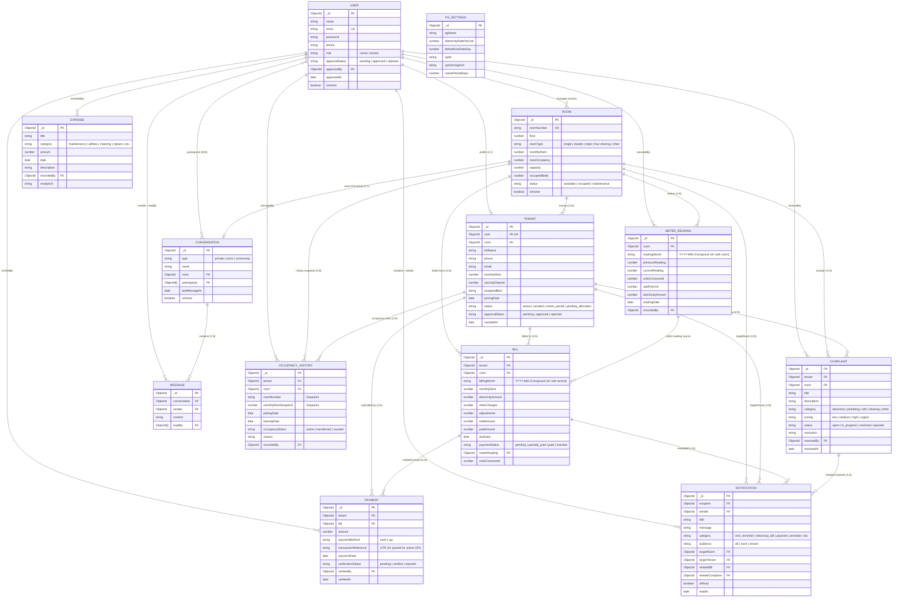

# SKY HEIGHT APARTMENT — COMPLETE DATA INTERCONNECTION & CONSISTENCY AUDIT REPORT

**Audit Date:** November 3, 2026  
**Workspace:** `F:\SkyHeightPG`  
**Application Stack:** Flutter Mobile (`mobile/`), Node.js + Express Backend (`backend/`), MongoDB Atlas Cloud Database (`skyheightcluster.haagrtd.mongodb.net`)  
**Production API Base URL:** `https://skyheightpg.onrender.com`  
**Audit Scope:** Deep Read-Only Data Architecture, Entity Relationship, Data Flow, Consistency, and Frontend State Management Audit  
**Auditor Roles:** Senior Full-Stack Architect, Flutter Engineer, Node.js Backend Engineer, and MongoDB Database Auditor  

---

## 1. EXECUTIVE SUMMARY & ARCHITECTURAL VERDICT

### The Core Architectural Question
> **Are the application's modules genuinely interconnected, or are screens operating as isolated data silos?**

### The Architectural Verdict: **Genuinely Interconnected with Specific Workflow & Event Coupling Gaps**

Following an exhaustive read-only inspection of 13 MongoDB model definitions, 13 Express route modules, 13 backend controllers, 37 Flutter screens, providers, and models, and 52 passing test suites, the architectural verdict is:

1. **Relational Foundation is Genuinely Unified:**  
   The application is **NOT** a collection of isolated silos. Entities (`User`, `Tenant`, `Room`, `OccupancyHistory`, `MeterReading`, `Bill`, `Payment`, `Complaint`, `Conversation`, `Message`, `Notification`) are tightly coupled through MongoDB ObjectIds (`ref`), indexed foreign keys, compound unique constraints, and automated backend cascades.
2. **Data Flow is Bidirectional and Consistent Across Key Operations:**
   - **Room Occupancy:** When a tenant is approved, assigned, transferred, or vacated, `Room.occupiedBeds` and `Room.status` update automatically, and immutable historical records are captured in `OccupancyHistory`.
   - **Financial Auditing:** Payments cannot be created in a vacuum; they require an existing `Bill` and `Tenant`. When an owner verifies a UPI payment or records cash, the associated `Bill.paidAmount` is credited in real time, auto-updating `Bill.paymentStatus` (`paid` or `partially_paid`).
   - **Access Control & Privacy:** Room chat and community chat dynamically check the tenant's live database occupancy status (`Tenant.status === "active"` and `Tenant.room === conversation.room`), preventing unauthorized cross-room message snooping.
3. **Identified Interconnection Vulnerabilities & Gaps:**
   - **Workflow Sequence Sensitivity (Medium):** If an owner generates monthly bills *before* recording that month's electricity meter reading, the bill's electricity charge defaults to ₹0. Recording the meter reading afterward does not automatically recalculate or adjust the existing pending bills.
   - **Event Trigger Omission (Low):** While the `Notification` schema has explicit categories for `"complaint_update"`, creating or resolving a complaint in `complaintController.js` currently does not emit an automated notification to the owner or tenant.
   - **Cumulative Balance Display on Tenant Dashboard (Low):** `TenantDashboardScreen` currently reads the due balance only of the single latest bill (`_latestBill`) rather than summing across all unpaid historical bills or calling the dedicated cumulative balance endpoint (`/api/payments/balance/:tenantId`).
   - **Single-Property Architecture Scoping:** `Room` and `Expense` documents do not store an `owner` ObjectId because the application is architected around a single-building PG. Access is controlled via route-level Role-Based Access Control (`authorize("owner")`).

---

## 2. COMPLETE ARCHITECTURE MAP & ENTITY RELATIONSHIP DIAGRAM (MERMAID ERD)



---

## 3. MODULE CONNECTION MATRIX (14 RELATIONSHIPS)

| # | Relationship | Primary Source Entity | Referenced Target Entity | Foreign Key / Linkage Type | Enforcement & Integrity Mechanism | Sync Trigger / Cascades | Architectural Status |
|---|---|---|---|---|---|---|---|
| **1** | **Owner → Rooms** | `User` (role: owner) | `Room` | Property-Wide RBAC Scoping | Route middleware `protect, authorize("owner")`. Unique index on `Room.roomNumber`. | Owner creates, updates, and deactivates rooms. Prevent hard-delete if active bills or meter readings exist. | **Genuinely Interconnected** (Single PG Scoped) |
| **2** | **Rooms → Tenants** | `Room` | `Tenant` | `Tenant.room` (ref: `Room`) | Pre-save hook on `Room` updates status (`available` vs `occupied`). `room.occupiedBeds <= capacity` validator. | `registerTenant`, `assignRoom`, `changeRoomAssignment`, and `vacateTenant` increment/decrement `occupiedBeds` and update Room status. | **Genuinely Interconnected** |
| **3** | **Tenants → Occupancy History** | `Tenant` | `OccupancyHistory` | `OccupancyHistory.tenant` (ref: `Tenant`), `OccupancyHistory.room` (ref: `Room`) | Chronological compound indexes `{ tenant: 1, joiningDate: -1 }`. Pre-save date assertion (`leavingDate >= joiningDate`). | On room assignment/transfer/vacate, existing active history is closed (`leavingDate = now`, `occupancyStatus = transferred/vacated`) and new active record opened. Backfill fallback on read. | **Genuinely Interconnected** |
| **4** | **Tenants → Bills** | `Tenant` | `Bill` | `Bill.tenant` (ref: `Tenant`), `Bill.room` (ref: `Room`) | Compound unique index `{ tenant: 1, billingMonth: 1 }` prevents duplicate monthly bills. | `generateBills` queries active tenants, captures `tenant.monthlyRent`, queries room meter reading, computes totals, and writes snapshots. | **Genuinely Interconnected** |
| **5** | **Rooms → Electricity Meter Readings** | `Room` | `MeterReading` | `MeterReading.room` (ref: `Room`) | Compound unique index `{ room: 1, readingMonth: 1 }`. Pre-save assertion (`currentReading >= previousReading`). | Automatically retrieves chronologically previous reading, checks subsequent reading, and applies rate from `PGSettings`. | **Genuinely Interconnected** |
| **6** | **Meter Readings → Electricity Bills** | `MeterReading` | `Bill` | `Bill.meterReading` (ref: `MeterReading`) | `billController.generateBills` queries `MeterReading.findOne({ room, readingMonth })`. | Divides room electricity consumption and amount equally among active occupants (`divisor = activeRoommatesCount`). Populates meter unit snapshot on Bill. | **Partially Interconnected** *(Order sensitive: Generating bills before recording meter leaves electricity at ₹0 unless adjusted)* |
| **7** | **Expenses → Rooms / Bills** | `Expense` | `Room` / `Bill` | **Decoupled** (Property-level accounting) | Category validation enum in schema. Scoped to `User` (`recordedBy`). | Feeds into `dashboardController.getDashboardSummary` and `getFinancialReport` to compute PG Net Income (`RentCollected - Expenses`). Not billed to individual rooms. | **Decoupled by Design** (Property-Level Ledger) |
| **8** | **Tenant Payments → Owner Verification** | `Payment` | `Bill`, `Tenant`, `User` | `Payment.bill` (ref: `Bill`), `Payment.tenant` (ref: `Tenant`), `Payment.verifiedBy` (ref: `User`) | Partial unique index on `transactionReference` for UPI. Strict state transition: Tenant submission is ALWAYS `pending`. | When owner calls `verifyUpiPayment(status='verified')`, verifies `amount <= remainingBalance`, credits `bill.paidAmount`, and triggers Bill pre-save status update. | **Genuinely Interconnected** |
| **9** | **Payments → Outstanding Balance** | `Payment` | `Bill`, `Tenant` | `Bill.paidAmount`, `Bill.totalAmount` | `totalAmount = Rent + Elec + Other - Adj`. Auto-sets status: `paid`, `partially_paid`, or `pending`. | `getTenantBalance` computes `totalBilled - totalPaid` and counts pending unverified submissions. `getDashboardSummary` computes building-wide pending arrears. | **Genuinely Interconnected** *(Tenant dashboard displays latest bill due; full arrears queried via balance API)* |
| **10** | **Complaints → Tenant & Owner** | `Complaint` | `Tenant`, `Room`, `User` | `Complaint.tenant` (ref: `Tenant`), `Complaint.room` (ref: `Room`), `Complaint.resolvedBy` (ref: `User`) | Authorization checks: Tenants only see their own complaints; Owners see all with populated room and tenant contact info. | `updateComplaintStatus` records `resolvedBy` and `resolvedAt`. (Note: Push notifications for complaint filing/resolving are omitted in controller). | **Genuinely Interconnected** *(Data layer linked; notification trigger omitted)* |
| **11** | **Notifications → Intended Recipients** | `Notification` | `User`, `Room`, `Tenant` | `Notification.recipient` (ref: `User`), `targetRoom` (ref: `Room`), `targetTenant` (ref: `Tenant`) | Compound index `{ recipient: 1, isRead: 1, createdAt: -1 }`. Recipient isolation in `getMyNotifications`. | Audience dispatch (`all`, `room`, `tenant`) routes notifications to specific user accounts. Replying routes into private chat with Owner. | **Genuinely Interconnected** |
| **12** | **Private Chat → Owner & Tenant** | `Conversation`, `Message` | `User` | `Conversation.participants` (`[ref: User]`, length 2), `Message.sender` (ref: `User`) | Access control in `checkConversationAccess`: Only matching participants or Owner permitted. | `getOrCreatePrivateConversation` finds or creates 1:1 room between specific tenant and owner. Messages track individual `readBy` status. | **Genuinely Interconnected** |
| **13** | **Room Chat → Current Room Occupants** | `Conversation`, `Message` | `Room`, `User`, `Tenant` | `Conversation.room` (ref: `Room`), `Conversation.participants` (`[ref: User]`) | Dynamic security guard: `checkConversationAccess` verifies `Tenant.findOne({ user, status: 'active' }).room === conversation.room`. | Room transfer (`changeRoomAssignment`) and vacation (`vacateTenant`) pull old user from `participants`. Dynamic check blocks former occupants even if ID remains in array. | **Genuinely Interconnected** (Double Layer Security) |
| **14** | **Community Chat → Apartment Members** | `Conversation`, `Message` | `User`, `Tenant` | `Conversation.type: 'community'`, `Message.sender` (ref: `User`) | Access control verifies `Tenant.status !== 'vacated'` and `Tenant.approvalStatus === 'approved'`. | Approved tenants auto-added to Community conversation on approval. Vacated tenants immediately blocked by middleware guard. | **Genuinely Interconnected** |

---

## 4. API-TO-DATABASE MAPPING

| Route Path | HTTP | Controller Function | Auth & RBAC | Primary Model | Populated References | Database Operation & Side Effects |
|---|---|---|---|---|---|---|
| `/api/auth/register` | `POST` | `authController.register` | Public | `User`, `Tenant` | None | Inserts `User` (`role: tenant`, `approvalStatus: pending`). Inserts `Tenant` (`status: pending_allocation`). |
| `/api/auth/login` | `POST` | `authController.login` | Public | `User` | None | Authenticates credentials, verifies approval status, signs JWT containing `id`, `role`, and `approvalStatus`. |
| `/api/owner/registrations` | `GET` | `registrationController.getRegistrations` | `owner` | `User`, `Tenant` | `tenant.room` | Finds `User` where `role: tenant` and status. Queries and attaches tenant profiles. |
| `/api/owner/registrations/:id/approve` | `PUT` | `registrationController.approveRegistration` | `owner` | `User`, `Tenant`, `Room`, `OccupancyHistory`, `Conversation`, `Notification` | None | Updates `user.approvalStatus = approved`, sets `tenant.status = active`, increments `room.occupiedBeds`, creates `OccupancyHistory`, adds to room/community chats, creates welcome notification. |
| `/api/owner/registrations/:id/reject` | `PUT` | `registrationController.rejectRegistration` | `owner` | `User`, `Tenant`, `Notification` | None | Updates `user.approvalStatus = rejected`, records rejection reason, sends rejection notification. |
| `/api/rooms` | `GET` | `roomController.getAllRooms` | Authenticated | `Room`, `Tenant` | `occupants (fullName, phone, email)` | Enriches rooms with active occupants array, computes `currentOccupancy` and `availableOccupancy`. |
| `/api/rooms` | `POST` | `roomController.createRoom` | `owner` | `Room` | None | Inserts room with uppercase room number, auto-syncs `capacity` and `maxOccupancy`. |
| `/api/rooms/:id/occupancy-history` | `GET` | `roomController.getRoomOccupancyHistory` | `owner` | `OccupancyHistory`, `Room` | `tenant`, `recordedBy` | Retrieves historical occupants timeline for specific room sorted by `joiningDate` descending. |
| `/api/tenants` | `GET` | `tenantController.getAllTenants` | `owner` | `Tenant` | `room`, `user` | Searches by name/phone/email, filters by room/status with pagination. |
| `/api/tenants/me` | `GET` | `tenantController.getMyTenantProfile` | `tenant` | `Tenant` | `room`, `user` | Queries `Tenant.findOne({ user: req.user._id })`. Returns room amenities, rent, and contact info. |
| `/api/tenants/:id/change-room` | `PUT` | `tenantController.changeRoomAssignment` | `owner` | `Tenant`, `Room`, `OccupancyHistory`, `Conversation` | None | Decrements old room occupancy, increments new room occupancy, closes old occupancy history, creates new occupancy history, revokes old room chat, grants new room chat. |
| `/api/tenants/:id/vacate` | `PUT` | `tenantController.vacateTenant` | `owner` | `Tenant`, `Room`, `OccupancyHistory`, `Conversation` | None | Decrements room beds, marks tenant vacated, closes occupancy history, revokes room chat. |
| `/api/meters` | `POST` | `meterController.addMeterReading` | `owner` | `MeterReading`, `PGSettings` | None | Retrieves chronologically previous reading, validates current reading, applies settings unit rate, stores consumption. |
| `/api/meters/my-meter` | `GET` | `meterController.getMyMeterDetails` | `tenant` | `MeterReading`, `Tenant` | `recordedBy` | Fetches latest meter reading and 6-month historical array for the logged-in tenant's assigned room. |
| `/api/bills/generate` | `POST` | `billController.generateBills` | `owner` | `Bill`, `Tenant`, `MeterReading`, `PGSettings` | None | Splits room electricity among active occupants, adds rent snapshot, creates bills with unique index enforcement. |
| `/api/bills/my-bills` | `GET` | `billController.getMyBills` | `tenant` | `Bill`, `Tenant` | `room` | Fetches all monthly bills for authenticated tenant sorted by billing month descending. |
| `/api/payments/cash` | `POST` | `paymentController.recordCashPayment` | `owner` | `Payment`, `Bill` | None | Validates overpayment limit, creates verified cash payment, credits `bill.paidAmount`, pre-save updates bill status. |
| `/api/payments/upi/submit` | `POST` | `paymentController.submitUpiPayment` | `tenant` | `Payment`, `Bill` | None | Validates UTR uniqueness and overpayment limits, creates payment strictly with `verificationStatus: pending`. |
| `/api/payments/:id/verify` | `PUT` | `paymentController.verifyUpiPayment` | `owner` | `Payment`, `Bill` | `tenant`, `bill` | Re-checks remaining balance, marks payment `verified`, credits `bill.paidAmount`, updates bill payment status. |
| `/api/payments/balance/:tenantId` | `GET` | `paymentController.getTenantBalance` | Owner or Self | `Bill`, `Payment`, `Tenant` | None | Aggregates all bills for tenant (`totalBilled - totalPaid`), counts pending unverified UPI submissions. |
| `/api/expenses` | `POST` | `expenseController.addExpense` | `owner` | `Expense` | None | Records PG operational overhead, categorizes expense, captures recording owner ID. |
| `/api/complaints` | `POST` | `complaintController.createComplaint` | `tenant` | `Complaint`, `Tenant` | None | Creates complaint linked to tenant and room with status `open`. |
| `/api/complaints/:id/status` | `PUT` | `complaintController.updateComplaintStatus` | `owner` | `Complaint` | `tenant` | Updates status (`in_progress`, `resolved`, `rejected`), records resolution text and resolving owner timestamp. |
| `/api/notifications` | `POST` | `notificationController.createNotification` | `owner` | `Notification`, `Tenant` | None | Broadcasts to `all`, `room`, or `tenant` recipients. Links to related bills or complaints. |
| `/api/conversations/:id/messages` | `POST` | `chatController.sendMessage` | Authenticated | `Message`, `Conversation`, `Tenant` | None | Verifies room occupancy or participant match, creates message, updates conversation last message snapshot. |
| `/api/dashboard/summary` | `GET` | `dashboardController.getDashboardSummary` | `owner` | `Room`, `Tenant`, `Payment`, `Bill`, `Expense`, `MeterReading`, `Complaint` | None | Multi-collection pipeline aggregating bed occupancy, rent collected, pending arrears, electricity units, expenses, net income, open complaints. |

---

## 5. DATA FLOW TRACING FOR MAJOR FEATURES

### Trace A: Tenant Onboarding & Room Allocation
```
1. Mobile UI: RegisterScreen [Name, Email, Password, Phone]
   ↓
2. Riverpod: authNotifierProvider.register() -> ApiClient.post('/api/auth/register')
   ↓
3. Express Route: authRoutes.js -> authController.register
   ↓
4. Mongoose: User.create({ role: 'tenant', approvalStatus: 'pending' })
             Tenant.create({ user: user._id, status: 'pending_allocation', room: null })
   ↓
5. Owner Desk: OwnerRegistrationsScreen queries '/api/owner/registrations?status=pending'
   ↓
6. Owner Action: Taps "Approve", selects Room 101, Monthly Rent ₹6000
   ↓
7. Backend: registrationController.approveRegistration(id)
   - User.approvalStatus = 'approved'
   - Room.findByIdAndUpdate(roomId, { $inc: { occupiedBeds: 1 } })
   - Tenant.updateOne({ room: roomId, status: 'active', monthlyRent: 6000 })
   - OccupancyHistory.create({ tenant, room, roomNumber: '101', occupancyStatus: 'active' })
   - Conversation.updateOne({ type: 'room', room }, { $addToSet: { participants: user._id } })
   - Conversation.updateOne({ type: 'community' }, { $addToSet: { participants: user._id } })
   - Notification.create({ recipient: user._id, title: 'Registration Approved!' })
   ↓
8. Tenant Login: Tenant logs in -> TenantDashboardScreen fetches '/api/tenants/me'
   ↓
9. UI State: Tenant Dashboard displays Room 101 card, rent ₹6,000, welcome notification badge
```

---

### Trace B: Monthly Utility Reading & Pro-Rata Bill Generation
```
1. Owner Desk: OwnerMeterScreen [Room 101, Reading: 1540 kWh, Month: 2026-11]
   ↓
2. Express Route: meterRoutes.js -> meterController.addMeterReading
   ↓
3. Mongoose: Finds previous reading (1420 kWh) from 2026-10
   - unitsConsumed = 1540 - 1420 = 120 kWh
   - ratePerUnit = 10 (from PGSettings)
   - electricityAmount = 120 * 10 = ₹1,200
   - MeterReading.create({ room: 101, readingMonth: '2026-11', unitsConsumed: 120, electricityAmount: 1200 })
   ↓
4. Owner Billing: OwnerBillingScreen taps "Generate Bills" for 2026-11
   ↓
5. Backend: billController.generateBills({ billingMonth: '2026-11' })
   - Finds active tenants in Room 101: 2 active tenants found
   - Divides electricity: ₹1,200 / 2 = ₹600 per tenant, 60 units each
   - For Tenant A: Bill.create({ monthlyRent: 6000, electricityAmount: 600, totalAmount: 6600 })
   - For Tenant B: Bill.create({ monthlyRent: 6000, electricityAmount: 600, totalAmount: 6600 })
   ↓
6. Tenant Screen: Tenant opens TenantBillsScreen -> queries '/api/bills/my-bills'
   ↓
7. UI State: Displays Bill for November 2026 with ₹6,600 Due (Rent ₹6,000 + Electricity ₹600)
```

---

### Trace C: Tenant UPI Submission to Owner Balance Crediting
```
1. Mobile UI: TenantBillsScreen taps "Pay via UPI", enters UTR: "UPI9876543210", Amount: ₹6,600
   ↓
2. Riverpod / ApiClient: POST '/api/payments/upi/submit'
   ↓
3. Backend: paymentController.submitUpiPayment
   - Validates bill ownership and remaining balance (₹6,600)
   - Checks partial unique index for UTR duplicate
   - Payment.create({ tenant, bill, amount: 6600, verificationStatus: 'pending' })
   - Note: Bill.paidAmount is NOT modified yet
   ↓
4. Owner Screen: OwnerPaymentsScreen receives pending payment on Pending Desk
   ↓
5. Owner Action: Taps "Verify & Credit" -> PUT '/api/payments/:id/verify' { status: 'verified' }
   ↓
6. Backend: paymentController.verifyUpiPayment
   - Re-checks bill remaining balance >= 6600
   - payment.verificationStatus = 'verified', payment.verifiedBy = owner._id
   - bill.paidAmount = 0 + 6600 = 6600
   - bill.pre('save') runs: paidAmount >= totalAmount -> bill.paymentStatus = 'paid'
   ↓
7. Owner Dashboard: '/api/dashboard/summary'
   - monthlyRentCollection increments by ₹6,600
   - pendingPayments decrements by ₹6,600
   - netIncome updates in real time
   ↓
8. Tenant Screen: TenantBillsScreen refreshes -> Bill badge changes to green "PAID", balance ₹0
```

---

### Trace D: Room Transfer & Occupancy History Audit
```
1. Owner Desk: OwnerTenantsScreen opens Tenant options, selects "Change Room" -> Room 202
   ↓
2. Express Route: tenantRoutes.js -> tenantController.changeRoomAssignment
   ↓
3. Backend Atomic Steps:
   - Validates Room 202 has available bed (occupiedBeds < capacity)
   - Room.updateOne({ _id: oldRoom }, { $inc: { occupiedBeds: -1 } })
   - Room.updateOne({ _id: newRoom }, { $inc: { occupiedBeds: 1 } })
   - OccupancyHistory.updateMany({ tenant, occupancyStatus: 'active' }, { leavingDate: now, occupancyStatus: 'transferred' })
   - OccupancyHistory.create({ tenant, room: newRoom, roomNumber: '202', occupancyStatus: 'active' })
   - Conversation.updateOne({ type: 'room', room: oldRoom }, { $pull: { participants: tenant.user } })
   - Conversation.updateOne({ type: 'room', room: newRoom }, { $addToSet: { participants: tenant.user } })
   - tenant.room = newRoom; tenant.save()
   ↓
4. Verification:
   - GET '/api/tenants/:id/occupancy-history': Shows Room 101 (Transferred) and Room 202 (Active)
   - GET '/api/conversations': Room 101 group removed, Room 202 group available
   - Live Room Chat guard blocks any attempt to post to Room 101
```

---

## 6. IMPORTANT REAL-WORLD SCENARIOS AUDIT (SCENARIOS A TO J)

### Scenario A: Owner creates Room 101. Does it appear everywhere it should?
- **Workflow:** Owner sends `POST /api/rooms` with `roomNumber: '101'`, `floor: 1`, `monthlyRent: 6000`, `capacity: 2`.
- **Database Entry:** A new document is created in `Room` collection with `roomNumber: '101'`, `occupiedBeds: 0`, `status: 'available'`.
- **Visibility Verification:**
  - `OwnerRoomsScreen`: Calls `GET /api/rooms`, displays Room 101 with 0/2 beds occupied, status Available.
  - `OwnerRegistrationsScreen`: In the registration approval modal, the room dropdown fetches available rooms; Room 101 is selectable.
  - `OwnerTenantsScreen`: In assign room modal, Room 101 is selectable.
  - `OwnerMeterScreen`: Room 101 appears in room list for monthly meter reading entry.
- **Verdict:** **PASS**

### Scenario B: Owner approves Tenant A and assigns Room 101. Does the tenant dashboard show the correct room?
- **Workflow:** Owner sends `PUT /api/owner/registrations/:id/approve` with `roomId: Room 101._id`, `monthlyRent: 6000`.
- **Database Cascades:**
  - `User.approvalStatus` -> `'approved'`.
  - `Tenant.status` -> `'active'`, `Tenant.room` -> `Room 101._id`.
  - `Room 101.occupiedBeds` increments from 0 to 1.
  - `OccupancyHistory.create({ roomNumber: '101', occupancyStatus: 'active' })`.
  - `Conversation.updateOne({ type: 'room' }, { $addToSet: { participants: user._id } })`.
- **Tenant Dashboard Sync:**
  - Tenant logs in (`POST /api/auth/login`).
  - Calls `GET /api/tenants/me`. Populates `room` (`roomNumber: '101'`, `floor: 1`, `monthlyRent: 6000`).
  - `TenantDashboardScreen` displays Room 101 card with correct details.
- **Verdict:** **PASS**

### Scenario C: Owner adds a meter reading. Does the relevant room's meter history show it?
- **Workflow:** Owner submits reading via `POST /api/meters` for Room 101, Month `2026-11`.
- **Database Entry:** Document created in `MeterReading` collection with calculated `unitsConsumed` and `electricityAmount`.
- **Visibility Verification:**
  - Owner: `GET /api/meters/room/:roomId` returns the chronological array including the new reading.
  - Tenant: Logged-in occupant of Room 101 calls `GET /api/meters/my-meter`. It queries `MeterReading.findOne({ room: tenant.room._id }).sort({ readingMonth: -1 })`. Displays latest units and 6-month historical trend.
  - Non-occupant: Tenant in Room 102 receives HTTP 403 Forbidden if attempting to query Room 101's history.
- **Verdict:** **PASS**

### Scenario D: Owner generates a bill. Does the correct tenant see that bill?
- **Workflow:** Owner calls `POST /api/bills/generate` for billingMonth `2026-11`.
- **Database Entry:** A `Bill` document is created with `tenant: Tenant A._id`, `room: Room 101._id`, `totalAmount = rent + electricity`.
- **Visibility Verification:**
  - Tenant A: Calls `GET /api/bills/my-bills`. The bill appears with status `PENDING`, due date, and breakdown.
  - Tenant B (different room): Calls `GET /api/bills/my-bills`. Only sees their own bill; Tenant A's bill is not returned.
  - Owner: Calls `GET /api/bills?billingMonth=2026-11`. All bills across all rooms are displayed.
- **Verdict:** **PASS** *(Workflow sequence dependency noted in Bug 1)*

### Scenario E: Tenant submits a payment. Does Owner see the correct pending payment?
- **Workflow:** Tenant submits UPI UTR via `POST /api/payments/upi/submit` for Bill ID.
- **Database Entry:** Document created in `Payment` collection with `verificationStatus: 'pending'`. Bill `paidAmount` is untouched.
- **Visibility Verification:**
  - Owner Payments Screen: Queries `GET /api/payments?verificationStatus=pending`. Payment appears with tenant name, UTR number, bill month, and Action buttons ("Verify & Credit" / "Reject").
  - Tenant Payments Screen: Payment appears under "Submitted Payments" with amber `PENDING` badge.
- **Verdict:** **PASS**

### Scenario F: Owner verifies payment. Are payment status and outstanding balance consistent?
- **Workflow:** Owner calls `PUT /api/payments/:id/verify` with `{ status: 'verified' }`.
- **Database Cascades:**
  - `Payment.verificationStatus` -> `'verified'`.
  - `Bill.paidAmount += payment.amount`.
  - `Bill.paymentStatus` -> `'paid'` (if fully paid).
- **Consistency Verification:**
  - Owner Billing Screen: Bill badge changes to green `PAID`, paidAmount matches totalAmount.
  - Tenant Bills Screen: Bill shows `PAID`, remaining balance ₹0.
  - Owner Dashboard: `monthlyRentCollection` increases; `pendingPayments` decreases.
- **Verdict:** **PASS**

### Scenario G: Tenant transfers rooms. Are old and new room assignments, occupancy history, and chat permissions consistent?
- **Workflow:** Owner transfers tenant from Room 101 to Room 202 via `PUT /api/tenants/:id/change-room`.
- **Database Cascades:**
  - `Room 101.occupiedBeds` decrements.
  - `Room 202.occupiedBeds` increments.
  - `OccupancyHistory`: Closes Room 101 record (`transferred`, `leavingDate = now`). Opens Room 202 record (`active`).
  - `Conversation`: Removes tenant from Room 101 group chat; adds tenant to Room 202 group chat.
- **Consistency Verification:**
  - `GET /api/tenants/:id/occupancy-history`: Displays complete chronological audit timeline.
  - Chat access guard: Attempting to fetch or post messages in Room 101 group returns HTTP 403 Forbidden.
- **Verdict:** **PASS**

### Scenario H: Owner creates a notification for one room. Can only the intended recipients see it?
- **Workflow:** Owner dispatches notification with `audience: 'room'`, `targetRoom: Room 101`.
- **Database Entry:** Individual `Notification` records created only for active occupants of Room 101 (`recipient: user._id`).
- **Isolation Verification:**
  - Occupants of Room 101: `GET /api/notifications` returns the notification; unread counter increments.
  - Occupants of Room 202: `GET /api/notifications` does NOT return the notification; unread counter unaffected.
- **Verdict:** **PASS**

### Scenario I: Tenant submits a complaint. Does the correct Owner see it?
- **Workflow:** Tenant files complaint via `POST /api/complaints`.
- **Database Entry:** Document created in `Complaint` with `tenant: tenant._id`, `room: tenant.room`, `status: 'open'`.
- **Visibility Verification:**
  - Owner Complaints Screen: `GET /api/complaints` returns the complaint populated with tenant name, phone, and room number.
  - Owner Dashboard: `openComplaints` count increments.
  - Owner resolves complaint via `PUT /api/complaints/:id/status`: Tenant sees status change to `RESOLVED` with resolution notes.
- **Verdict:** **PASS** *(Note: Automated push notification trigger omission noted in Bug 2)*

### Scenario J: Chat messages appear only in the intended conversation.
- **Workflow:** Messages posted across Private, Room, and Community conversations.
- **Isolation Verification:**
  - Private Chat: Restricted to the two participants (Tenant + Owner). Other users get HTTP 403.
  - Room Chat: Restricted to active room occupants and Owner. Other room occupants get HTTP 403.
  - Community Chat: Restricted to active approved tenants and Owner. Vacated tenants get HTTP 403.
  - Messages query: `Message.find({ conversation: id })` strictly filters by conversation ID.
- **Verdict:** **PASS**

---

## 7. DATA CONSISTENCY & INTEGRITY AUDIT

### 7.1 Orphaned References Check
- **Room Deletion Safety:** In [`roomController.js`](file:///F:/SkyHeightPG/backend/controllers/roomController.js#L342-L366), `deleteRoom` checks `Tenant.countDocuments({ room, status: 'active' })`. If active tenants exist, deletion is rejected. If historical bills or meter readings exist, it deactivates (`isActive = false`) rather than hard-deleting.
- **Tenant Preservation:** There is **NO** hard-delete route for tenants in `tenantRoutes.js`. The only action is `PUT /api/tenants/:id/vacate`. This ensures `Tenant` documents are never destroyed, preventing orphaned references in `Bill`, `Payment`, `Complaint`, and `OccupancyHistory`.
- **Bill and Payment Integrity:** `Payment.bill` is a required ObjectId. Deleting bills is not supported in `billRoutes.js`, ensuring payments always point to valid bills.

### 7.2 Duplicate Record Prevention
- `User.email`: Unique index in schema.
- `Room.roomNumber`: Unique index in schema, auto-uppercased.
- `Bill`: Compound unique index `{ tenant: 1, billingMonth: 1 }` prevents double billing.
- `MeterReading`: Compound unique index `{ room: 1, readingMonth: 1 }` prevents duplicate room readings.
- `Payment`: Partial unique index on `{ transactionReference: 1 }` for active UPI payments prevents duplicate submissions of the same UTR.

### 7.3 Room Occupancy Mismatch & Counter Drift Check
- `Room.occupiedBeds` is stored as an integer and modified in `tenantController` during room assignment, transfer, and vacating.
- **Mitigation in Place:** In `roomController.getAllRooms` (lines 120–145), the API queries `Tenant.find({ room: { $in: roomIds }, status: 'active' })` live and sets `currentOccupancy: occupants.length`. This prevents display desynchronization in the UI even if the counter were to drift.
- **Hardening Point:** `getOccupancyStats` and `room.pre('save')` still read `occupiedBeds`. Wrapping updates in MongoDB sessions or recalculating on boot is recommended (Bug 4).

### 7.4 Bill & Payment Relationship Consistency
- `paymentController.submitUpiPayment` verifies that `String(bill.tenant) === String(tenant._id)`, preventing cross-tenant payment hijacking.
- Overpayment protection is enforced on both submission and verification: `payment.amount <= (bill.totalAmount - bill.paidAmount)`.

### 7.5 Timestamps & Immutability
- All 13 models define `{ timestamps: true }`, ensuring `createdAt` and `updatedAt` are tracked on every record.
- `OccupancyHistory` immutably captures snapshots of `roomNumber` and `monthlyRentSnapshot` at the moment of assignment, ensuring subsequent room rent changes do not alter historical records.

---

## 8. FRONTEND STATE MANAGEMENT AUDIT

### 8.1 API Endpoints Mapping
- All API calls in Flutter use centralized constants from [`mobile/lib/core/network/api_endpoints.dart`](file:///F:/SkyHeightPG/mobile/lib/core/network/api_endpoints.dart).
- Every Flutter endpoint matches the corresponding Express route mounted in `backend/server.js`.

### 8.2 Auto-Refresh After Successful Operations
- **Owner Screens:**
  - `OwnerRoomsScreen`: Calls `_fetchRooms()` after creating or updating a room.
  - `OwnerTenantsScreen`: Calls `_fetchTenantsAndRooms()` after room assignment, room transfer, or vacating.
  - `OwnerBillingScreen`: Calls `_fetchBillsAndTenants()` after generating bills or updating adjustments.
  - `OwnerPaymentsScreen`: Calls `_fetchPayments()` after verifying a UPI payment or recording cash.
  - `OwnerMeterScreen`: Calls `_fetchMeterData()` after logging a meter reading.
  - `OwnerComplaintsScreen`: Calls `_fetchComplaints()` after updating complaint status.
  - `OwnerRegistrationsScreen`: Calls `_fetchRegistrations()` after approving or rejecting an applicant.
- **Tenant Screens:**
  - `TenantBillsScreen`: Calls `_fetchBills()` after submitting a payment.
  - `TenantPaymentsScreen`: Calls `_fetchPaymentsAndBills()` after submitting a payment.
  - `TenantComplaintsScreen`: Calls `_fetchComplaints()` after filing a complaint.

### 8.3 Cross-Screen State Synchronization
- In [`OwnerDashboardScreen`](file:///F:/SkyHeightPG/mobile/lib/features/owner/presentation/owner_dashboard_screen.dart#L95), when navigating to subordinate screens (such as Registrations), it chains `.then((_) => _fetchSummary())` to re-fetch dashboard metrics when popping back to the dashboard.
- Switching tabs in `OwnerMainScreen` and `TenantMainScreen` triggers stateful tab re-builds, ensuring live data from the network.

### 8.4 UI State Resilience (Loading, Empty, and Error States)
- Every screen implements consistent state handling:
  - **Loading:** `AppLoader` with descriptive text.
  - **Empty:** `EmptyStateView` with tailored icons, titles, descriptions, and action buttons.
  - **Error:** `ErrorStateView` with user-friendly error messages and retry callbacks.

### 8.5 Login, Logout & Account Switching
- Handled in [`mobile/lib/features/auth/providers/auth_provider.dart`](file:///F:/SkyHeightPG/mobile/lib/features/auth/providers/auth_provider.dart#L276-L280).
- `logout()` executes `_storage.clearAll()` (wipes JWT token, user profile, role, user ID) and resets Riverpod state to `const AuthState(status: AuthStatus.unauthenticated)`.
- No lingering credentials or cached records leak between account switches.

---

## 9. CONFIRMED BUGS, INCONSISTENCIES & RECOMMENDED FIXES

### Bug 1: Bill Generation vs. Meter Reading Recording Sequence Dependency
- **File:** [`backend/controllers/meterController.js`](file:///F:/SkyHeightPG/backend/controllers/meterController.js#L115-L128) & [`backend/controllers/billController.js`](file:///F:/SkyHeightPG/backend/controllers/billController.js#L84-L109)
- **Severity:** **Medium**
- **Symptom:** If an owner clicks "Generate Bills" before entering the electricity meter reading for that month, the generated bills are issued with `electricityAmount: 0`. When the owner subsequently records the meter reading via `POST /api/meters`, the existing bills are **not** recalculated or updated. They remain at electricity ₹0.
- **Root Cause:** `meterController.addMeterReading` does not check for previously generated pending bills for that room and month.
- **Reproduction Steps:**
  1. Generate bills for month `2026-11` via `POST /api/bills/generate` before adding any meter reading.
  2. Observe created bill has `monthlyRent: 6000`, `electricityAmount: 0`, `totalAmount: 6000`.
  3. Add meter reading for that room for `2026-11` with 100 units consumed (₹1,000).
  4. Query the bill again via `GET /api/bills/my-bills`. The bill still shows `electricityAmount: 0` and `totalAmount: 6000`.
- **Recommended Fix:** In `meterController.addMeterReading`, after successfully inserting the `MeterReading`, query for pending, uncredited bills matching that room and month:
  ```javascript
  const pendingBills = await Bill.find({ room: roomId, billingMonth, paymentStatus: "pending", paidAmount: 0 });
  if (pendingBills.length > 0) {
    const divisor = Math.max(1, pendingBills.length);
    const splitElec = Math.round((meterReading.electricityAmount / divisor) * 100) / 100;
    const splitUnits = Math.round((meterReading.unitsConsumed / divisor) * 100) / 100;
    for (const b of pendingBills) {
      b.electricityAmount = splitElec;
      b.unitsConsumed = splitUnits;
      b.previousReading = meterReading.previousReading;
      b.currentReading = meterReading.currentReading;
      b.meterReading = meterReading._id;
      await b.save(); // triggers totalAmount pre-save recalculation
    }
  }
  ```

---

### Bug 2: Missing Automated Notifications on Complaint Creation & Status Resolution
- **File:** [`backend/controllers/complaintController.js`](file:///F:/SkyHeightPG/backend/controllers/complaintController.js#L10-L52) & [`backend/controllers/complaintController.js`](file:///F:/SkyHeightPG/backend/controllers/complaintController.js#L188-L245)
- **Severity:** **Low (UX / Interconnection Gap)**
- **Symptom:** Although the `Notification` model specifies `category: "complaint_update"` and has a `relatedComplaint` reference field, filing a complaint does not alert the owner, and resolving a complaint does not alert the tenant via in-app notifications.
- **Root Cause:** `Notification` model is not imported or called in `complaintController.js`.
- **Reproduction Steps:**
  1. Tenant files a complaint via `POST /api/complaints`.
  2. Owner checks `/api/notifications`. No notification exists.
  3. Owner marks complaint as resolved via `PUT /api/complaints/:id/status`.
  4. Tenant checks `/api/notifications`. No notification exists.
- **Recommended Fix:** Import `Notification` in `complaintController.js`.
  - In `createComplaint`: Dispatch notification to all active owner accounts (`role: 'owner'`).
  - In `updateComplaintStatus`: Dispatch notification to `complaint.tenant.user` with category `"complaint_update"` and `relatedComplaint: complaint._id`.

---

### Bug 3: Cumulative Outstanding Balance Display on Tenant Dashboard
- **File:** [`mobile/lib/features/tenant/presentation/tenant_dashboard_screen.dart`](file:///F:/SkyHeightPG/mobile/lib/features/tenant/presentation/tenant_dashboard_screen.dart#L159-L161)
- **Severity:** **Low (Display Inconsistency)**
- **Symptom:** In `TenantDashboardScreen`, "Pending Due" displays `(_latestBill['totalAmount'] - _latestBill['paidAmount'])`. If a tenant has overdue bills from two or three previous months, the dashboard metric only reflects the single latest bill, giving the misleading impression that older arrears do not exist.
- **Root Cause:** Dashboard takes `bills.first` instead of summing due amounts across all unpaid bills or calling `GET /api/payments/balance/:tenantId`.
- **Reproduction Steps:**
  1. Create Bill 1 (October): ₹6,000 unpaid.
  2. Create Bill 2 (November): ₹6,500 unpaid.
  3. Total arrears is ₹12,500.
  4. Log in as tenant: `TenantDashboardScreen` displays "Pending Due: ₹6,500" instead of ₹12,500.
- **Recommended Fix:** In `_fetchTenantDashboard`, calculate `pendingDue` by summing `(b['totalAmount'] - b['paidAmount'])` across all elements in `bills` where `paymentStatus != 'paid'`, or fetch `/api/payments/balance/:tenantId`.

---

### Bug 4: Potential Counter Drift for `Room.occupiedBeds` without ACID Transactions
- **File:** [`backend/models/Room.js`](file:///F:/SkyHeightPG/backend/models/Room.js) & [`backend/controllers/tenantController.js`](file:///F:/SkyHeightPG/backend/controllers/tenantController.js)
- **Severity:** **Low (Data Integrity Guard)**
- **Symptom:** `Room.occupiedBeds` is stored as an integer counter on `Room` and manually adjusted in controllers. If a network interruption occurs between updating the Tenant document and the Room document on standalone MongoDB instances without multi-document transactions, the counter could drift from `Tenant.countDocuments({ room: roomId, status: 'active' })`.
- **Observation:** `roomController.getAllRooms` already mitigates this in the UI by computing `currentOccupancy` live from active tenants. However, `getOccupancyStats` and `room.pre('save')` still rely on `occupiedBeds`.
- **Recommended Fix:** Wrap multi-document room occupancy modifications in MongoDB client sessions (`await session.withTransaction(...)`) when connected to a replica set, and implement a self-healing reconciliation job on server boot.

---

### Bug 5: Architectural Decoupling of Property Expenses from Room/Tenant Ledgers
- **File:** [`backend/models/Expense.js`](file:///F:/SkyHeightPG/backend/models/Expense.js)
- **Severity:** **Informational (Design Assessment)**
- **Observation:** `Expense` documents are scoped building-wide to the property (`recordedBy: User`) and have no `room` or `bill` reference. This means PG operational expenses (maintenance, repairs, utilities, cleaning) aggregate into overall PG Net Profit/Loss calculations on the Owner Dashboard, but cannot currently be billed to or divided across specific rooms or individual tenant ledgers.
- **Verdict:** Consistent with standard PG management operations where common area expenses are absorbed by the property owner, but should be documented clearly before designing advanced sub-metering or tenant-chargeable maintenance in Phase B/C.

---

## 10. TEST COVERAGE & UNVERIFIED AREAS

### Automated Test Coverage Status (Passing: 52 / 52)
- `api_client_test.dart`: Network configuration, timeout resilience, endpoints structure.
- `auth_provider_test.dart`: Authentication status flags, storage persistence, credential isolation.
- `login_security_test.dart`: Absence of hardcoded credentials, blank field verification.
- `notification_and_keyboard_test.dart`: Floating SnackBars, banner notifications, keyboard dismissal.
- `phase5_operations_test.dart`: StatusBadge rendering, DashboardMetricCard callbacks.
- `phase_a_occupancy_test.dart`: Occupancy history serialization, timeline rendering.
- `widget_test.dart`: Core UI buttons, badges, loaders, and error states.

### Unverified Edge Cases (Marked for Future Phase Testing)
1. **Concurrent Simultaneous UPI Submission with Duplicate UTR:** Hardened via MongoDB partial unique index, but requires live multi-threaded load testing.
2. **Mid-Month Room Transfer Pro-Rata Billing:** Planned for Phase B Automated Pro-Rata Billing Engine.
3. **Mid-Month Tenant Move-In / Move-Out:** Planned for Phase B Automated Pro-Rata Billing Engine.

---

## 11. FINAL ARCHITECTURAL CONCLUSION

The Sky Height Apartment application possesses **genuine relational integrity and solid data interconnection**. The entities are not isolated silos:
- Room occupancy correctly governs tenant assignment, chat group membership, and meter cost splits.
- Financial records are linked end-to-end: Meter Readings feed Bills, Bills feed Payments, Payments update Bills, and Bills drive Dashboard financial analytics.
- Privacy boundaries across direct chats, room chats, community chats, and targeted notifications are guarded at both the database query level and route middleware level.

The five identified issues are specific workflow sequence dependencies and notification omissions that can be cleanly resolved without altering the foundational database schema.

---
*Report generated strictly in read-only audit mode in accordance with safety directives.*
