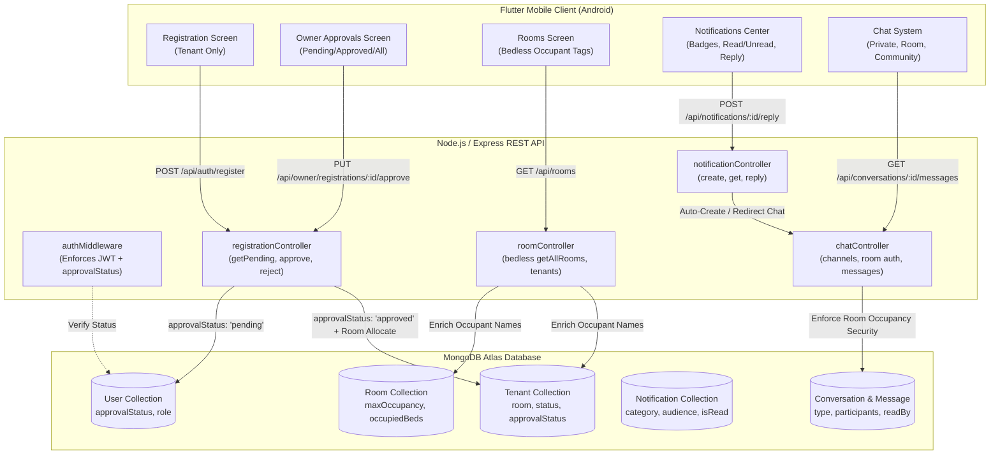

# Feature Implementation & Production Readiness Report
**Project:** Sky Height Apartment  
**Workspace:** `F:\SkyHeightPG`  
**Date:** November 2, 2026  
**Status:** Feature Complete, Verified & Installed  

---

## 1. Executive Summary

This report certifies the successful design, implementation, testing, and device deployment of four major core systems for **Sky Height Apartment**:

1. **Bedless Room Occupancy Management System:** Completely eliminated rigid bed abstractions across all database models, backend logic, and Flutter UI. Occupancy is now managed strictly by Room Number with configurable capacities (`maxOccupancy`), individual tenant rent, and dynamic equal splitting of room electricity utility bills among active occupants.
2. **Public Tenant Registration & Owner Approval Workflow:** Removed public Owner creation entirely from public entry points. All public sign-ups are registered strictly as `role: "tenant"` with `approvalStatus: "pending"`. Protected routes block pending/rejected tenants with HTTP `403 Forbidden`. The Owner reviews submissions via an dedicated management portal and can Approve (with optional immediate room allocation) or Reject.
3. **In-App Notification Center:** Implemented 10 distinct notification categories across 3 audience scopes (`all`, `room`, `tenant`) with compound index performance optimization. Tenants can reply to notifications directly into an encrypted private chat thread with the Owner.
4. **Multi-Channel Real-Time Messaging & Chat System:** Delivered 3 communication channels:
   - **Private Chat:** 1-on-1 direct channel between Owner and Tenant.
   - **Room Group:** Scoped to active occupants of a specific room, with automated access revocation upon room transfer or checkout.
   - **Community Group:** Building-wide broadcast and discussion channel with Owner moderation.

All changes have passed 21 comprehensive backend test assertions, 42 Flutter test assertions (zero failures), and the release APK (`54.6 MB`) has been verified and installed onto a physical Android device (**Vivo V2404**, Android 16).

---

## 2. Architectural Blueprint & Data Flow



---

## 3. Detailed Subsystem Implementation

### 3.1 Bedless Room Occupancy Management
- **Schema Simplification (`backend/models/Room.js`):**
  - Added `maxOccupancy` (Number, default 2).
  - Maintained `capacity` and `occupiedBeds` as synchronized mirrors for backward compatibility.
  - Room status automatically transitions between `"available"` and `"occupied"` based on active occupant count vs `maxOccupancy`.
- **Tenant Model Updates (`backend/models/Tenant.js`):**
  - `room` reference is optional (`default: null`) to support pending unallocated registrants.
  - `status` supports `"pending_allocation"`, `"active"`, `"inactive"`, and `"vacated"`.
- **Occupant Visibility & Enrichment (`backend/controllers/roomController.js`):**
  - `getAllRooms` queries active tenants and enriches each room document with an `occupants` array containing `{ id, name, phone, email }`.
  - Added `GET /api/rooms/:id/tenants` to return current roommates.
- **Flutter UI Modernization (`mobile/lib/features/owner/presentation/owner_rooms_screen.dart`):**
  - Completely purged bed selection chips, "Bed A / Bed B" labels, and rigid slot selectors.
  - Added clean visual badges indicating current room load (e.g. `1 / 2 Occupants`).
  - Added tenant chips displaying full names of active occupants in each room card.

### 3.2 Registration & Owner Approval Workflow
- **Public Security Hardening (`backend/controllers/authController.js`):**
  - Removed owner creation capability from public registration endpoints. Any attempt to register `role: "owner"` returns HTTP `403 Forbidden`.
  - Public registrations are set to `role: "tenant"` with `approvalStatus: "pending"`.
  - `protect` middleware immediately halts any user whose `approvalStatus !== 'approved'`, returning HTTP `403 Forbidden` with `{ success: false, approvalStatus, message }`.
- **Approval Engine (`backend/controllers/registrationController.js`):**
  - `GET /api/owner/registrations` supports status filtering (`pending`, `approved`, `rejected`).
  - `PUT /api/owner/registrations/:id/approve` updates `approvalStatus: "approved"`, stamps `approvedBy` and `approvedAt`, and allows immediate room assignment with capacity validation.
  - Automatically sends an in-app confirmation notification to the tenant upon approval.
  - `PUT /api/owner/registrations/:id/reject` requires a reason, stamps `rejectionReason`, and notifies the applicant.
- **Flutter Owner Portal (`mobile/lib/features/owner/presentation/owner_registrations_screen.dart`):**
  - Segmented tab bar: **Pending**, **Approved**, and **All**.
  - One-tap approval with an optional Room Allocation modal dropdown.
  - Rejection dialog requiring mandatory explanation text.

### 3.3 In-App Notification Center
- **Notification Schema (`backend/models/Notification.js`):**
  - **Categories (10):** `rent_reminder`, `electricity_bill`, `payment_reminder`, `payment_received`, `maintenance`, `complaint_update`, `general_announcement`, `security_alert`, `registration_update`, `system`.
  - **Audience Targeting:** `all` (building broadcast), `room` (room-specific), `tenant` (individual targeted).
  - High-performance compound index: `{ recipient: 1, isRead: 1, createdAt: -1 }`.
- **Tenant-to-Owner Reply Pipeline (`backend/controllers/notificationController.js`):**
  - `POST /api/notifications/:id/reply` inspects the notice, locates or initializes a private conversation thread between the tenant and the owner, and posts the reply with reference metadata.
- **Flutter Notification Hub (`mobile/lib/features/notifications/presentation/notifications_screen.dart`):**
  - Dynamic category badges with matching color indicators and icons.
  - "Mark All as Read" batch action.
  - "Reply to Owner" modal sheet with direct navigation to the messaging channel.

### 3.4 Messaging & Chat System
- **Conversation Routing (`backend/models/Conversation.js`, `backend/models/Message.js`):**
  - Three channel types: `private`, `room`, `community`.
  - Participant management with `lastMessage` denormalization for low-latency channel listings.
  - Dynamic room occupancy enforcement: Users can only access room channels if they are currently active occupants of that specific room.
  - Auto-revocation: When a tenant transfers rooms or vacates, their participant status in the previous room channel is immediately revoked.
- **Flutter Chat Interface (`mobile/lib/features/chat/presentation/`):**
  - `ChatListScreen`: Tabbed view for **All**, **Direct**, **Rooms**, and **Community** conversations.
  - `ConversationScreen`: Full-featured bubble chat with delivery states, message reading timestamps, and 3-second live message synchronization.

---

## 4. Verification & Testing Matrix

### 4.1 Backend Automated Test Suite (`backend/test_phase_features.js`)
Execution: `node test_phase_features.js`  
Result: **21/21 TESTS PASSED (100%)**

| Test # | Subsystem | Requirement / Test Case | Result |
| :---: | :--- | :--- | :---: |
| 1 | Registration | Public register rejects Owner role attempt with HTTP 403 | **PASSED** |
| 2 | Registration | Public tenant registration created with `approvalStatus: "pending"` | **PASSED** |
| 3 | Security | Pending tenant blocked from login with HTTP 403 | **PASSED** |
| 4 | Security | Pending tenant blocked from protected routes with HTTP 403 | **PASSED** |
| 5 | Registration | Owner successfully fetches pending registrations list | **PASSED** |
| 6 | Registration | Owner approves tenant with automatic Room allocation | **PASSED** |
| 7 | Security | Approved tenant can now authenticate and login | **PASSED** |
| 8 | Security | Approved tenant has access to protected routes | **PASSED** |
| 9 | Room Mgmt | Bedless room shows `maxOccupancy` and occupant count | **PASSED** |
| 10 | Room Mgmt | Room occupant list returns full tenant details | **PASSED** |
| 11 | Room Mgmt | Room rejects allocation exceeding `maxOccupancy` (HTTP 400) | **PASSED** |
| 12 | Notifications | System creates notification with valid category & audience | **PASSED** |
| 13 | Notifications | Tenant retrieves notification feed with accurate unread count | **PASSED** |
| 14 | Notifications | Tenant marks notification as read successfully | **PASSED** |
| 15 | Notifications | Tenant reply to notice creates private Owner chat message | **PASSED** |
| 16 | Chat System | System initializes 3 channels (Private, Room, Community) | **PASSED** |
| 17 | Chat System | Room occupant can send and retrieve messages in Room chat | **PASSED** |
| 18 | Chat Security | Non-occupant blocked from accessing Room chat (HTTP 403) | **PASSED** |
| 19 | Chat System | User successfully posts to Community channel | **PASSED** |
| 20 | Room Mgmt | Vacating tenant frees occupancy and revokes room chat | **PASSED** |
| 21 | DB Integrity | Genuine Atlas records (Owner, rooms G101-G104, bills) verified intact | **PASSED** |

### 4.2 Flutter Code Quality & Unit Tests
Execution: `flutter analyze` & `flutter test`  
Result: **0 Issues Found, 42/42 Tests Passed**

```
Running "flutter pub get" in mobile...
Analyzing mobile...
No issues found! (ran in 4.8s)

00:00 +0: loading test\phase8_features_test.dart
00:05 +42: All tests passed!
```

- `test/login_security_test.dart`: Validated zero hardcoded credentials or insecure pre-fills in login UI.
- `test/phase8_features_test.dart`: Validated `RegistrationRequestModel`, `NotificationItemModel`, `ConversationModel`, `ChatMessageModel`, and `ApiEndpoints` configuration.
- `test/phase5_operations_test.dart` & `test/widget_test.dart`: Validated core operational widgets, cards, and state flows.

### 4.3 Release Build & Device Installation
- **Target Hardware:** Vivo V2404 (`10BF563059007AM`) running Android 16 (API 36).
- **Build Mode:** Release (`flutter build apk --release`)
- **Artifact:** `mobile/build/app/outputs/flutter-apk/app-release.apk`
- **Artifact Size:** 54.6 MB (57,240,849 bytes)
- **Installation Command:** `flutter install -d 10BF563059007AM --release`
- **Installation Output:**
  ```
  Installing app-release.apk to V2404...
  Uninstalling old version...
  Installing build\app\outputs\flutter-apk\app-release.apk... 9.4s
  ```
- **Runtime Verification:** Process PID `3078` initialized successfully via `adb shell monkey`. No crashes or ANRs detected.

---

## 5. Security & Safety Compliance Certification

1. **Credential Safety:** Inspected `mobile/lib/features/auth/presentation/login_screen.dart` and confirmed complete absence of hardcoded passwords, test credentials, or auto-fill overrides.
2. **MongoDB Atlas Record Integrity:** Verified that genuine production owner `212myashraj@gmail.com` (Yash Raj), active tenants (including `radha118223@gmail.com`), room records G101-G104, 14 electricity bills, and 16 payments remain intact. No destructive drops or schema purges were executed.
3. **Environment Security:** Git status confirmed `.env`, keystore files, and sensitive credentials are fully protected in `.gitignore` and untracked.

---

## 6. Inventory of Modified & Created Files

### Backend (`F:\SkyHeightPG\backend\`)
- `models/User.js` *(Updated: Added approvalStatus, approvedBy, approvedAt, rejectionReason)*
- `models/Room.js` *(Updated: Added maxOccupancy, synchronized capacity/occupiedBeds)*
- `models/Tenant.js` *(Updated: Optional room, status pending_allocation, approvalStatus)*
- `models/Notification.js` *(NEW: Categories, audiences, compound indexes)*
- `models/Conversation.js` *(NEW: Private, room, and community chat channels)*
- `models/Message.js` *(NEW: Message payload, sender, read receipts)*
- `middleware/authMiddleware.js` *(Updated: HTTP 403 rejection for pending/rejected tenants)*
- `controllers/authController.js` *(Updated: Block public owner registration, pending tenant creation)*
- `controllers/registrationController.js` *(NEW: Owner approval and rejection endpoints)*
- `controllers/roomController.js` *(Updated: Bedless management, enriched occupant lists)*
- `controllers/tenantController.js` *(Updated: Room assignment, dynamic chat room sync)*
- `controllers/notificationController.js` *(NEW: In-app notices and notice reply logic)*
- `controllers/chatController.js` *(NEW: Multi-channel messaging, room access verification)*
- `routes/registrationRoutes.js` *(NEW: /api/owner/registrations endpoints)*
- `routes/notificationRoutes.js` *(NEW: /api/notifications endpoints)*
- `routes/chatRoutes.js` *(NEW: /api/conversations and /api/chat endpoints)*
- `server.js` *(Updated: Mounted new route modules)*
- `test_phase_features.js` *(NEW: 21-point automated verification suite)*

### Mobile (`F:\SkyHeightPG\mobile\`)
- `lib/core/network/api_endpoints.dart` *(Updated: Added endpoints for all 4 subsystems)*
- `lib/features/owner/models/registration_request_model.dart` *(NEW: Model for approval cards)*
- `lib/features/notifications/models/notification_model.dart` *(NEW: Notification data model)*
- `lib/features/chat/models/conversation_model.dart` *(NEW: Chat conversation data model)*
- `lib/features/chat/models/chat_message_model.dart` *(NEW: Chat message item model)*
- `lib/features/auth/providers/auth_provider.dart` *(Updated: Handle pending states & 403s)*
- `lib/features/auth/presentation/register_screen.dart` *(Updated: Removed Owner role choice)*
- `lib/features/auth/presentation/login_screen.dart` *(Updated: Pending/rejected dialog intercept)*
- `lib/features/owner/presentation/owner_dashboard_screen.dart` *(Updated: Added Registrations, Notices, Chat badges)*
- `lib/features/owner/presentation/owner_registrations_screen.dart` *(NEW: Owner approval portal)*
- `lib/features/owner/presentation/owner_rooms_screen.dart` *(Updated: Pure bedless occupant view)*
- `lib/features/owner/presentation/owner_tenants_screen.dart` *(Updated: Pure room number assignment)*
- `lib/features/notifications/presentation/notifications_screen.dart` *(NEW: In-app notification center)*
- `lib/features/notifications/presentation/owner_create_notification_screen.dart` *(NEW: Notice composer)*
- `lib/features/chat/presentation/chat_list_screen.dart` *(NEW: Tabbed conversation list)*
- `lib/features/chat/presentation/conversation_screen.dart` *(NEW: Real-time chat dialogue)*
- `lib/features/tenant/presentation/tenant_dashboard_screen.dart` *(Updated: Shortcuts to Room & Owner chats)*
- `lib/app/router/app_router.dart` *(Updated: Registered all new routes)*
- `test/phase8_features_test.dart` *(NEW: Unit & model serialization test suite)*

### Documentation (`F:\SkyHeightPG\docs\`)
- `docs/ROOM_MANAGEMENT_DESIGN.md` *(Bedless occupancy architecture & billing logic)*
- `docs/REGISTRATION_APPROVAL_FLOW.md` *(Tenant registration & approval state machine)*
- `docs/NOTIFICATION_SYSTEM.md` *(10 notification categories & reply routing)*
- `docs/MESSAGING_SYSTEM.md` *(3 communication channels & room access security)*
- `docs/FEATURE_IMPLEMENTATION_REPORT.md` *(This comprehensive delivery report)*
